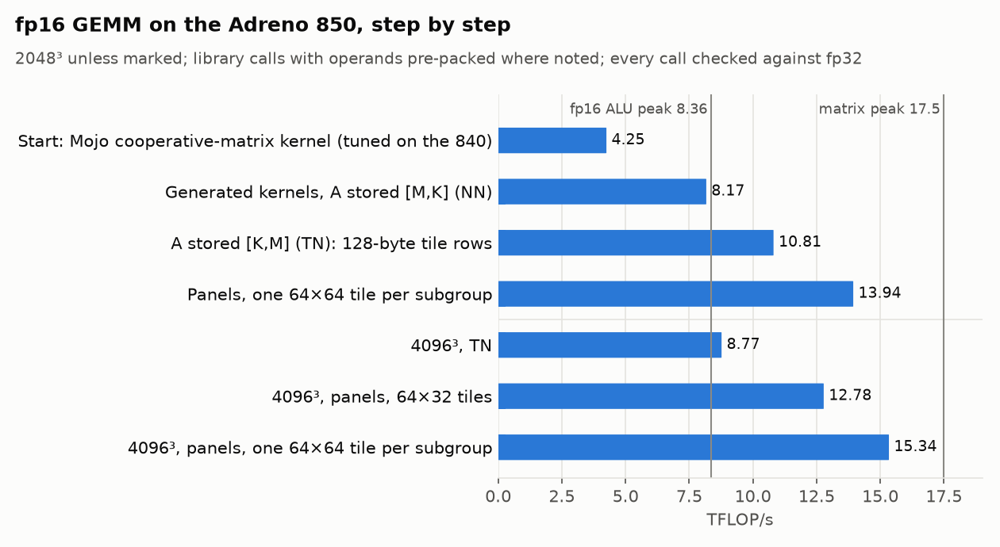
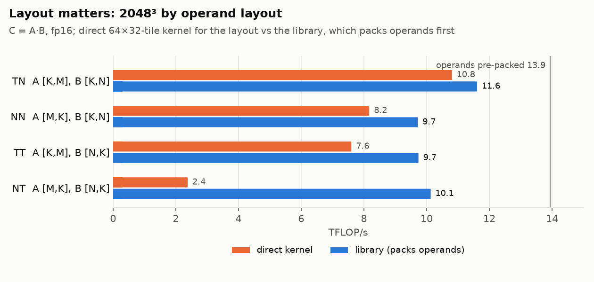

# AdrenoBLAS: fp16 GEMM at 88% of a Phone GPU's Matrix Peak

*Part 5 of [Bringing PyTorch LLMs to a Mid-Range Adreno GPU with IREE](https://github.com/adityaGoCT/iree-adreno-genai-tuner/blob/main/BLOG.md) (Part 4: [A Native GPU Target, and Llama Prefill on the Matrix Units](BLOG-COOPMAT.md)) · November 21, 2026 · Aditya*

## TL;DR

I set out to build a GEMM library for Adreno GPUs in the spirit of cuBLAS and rocBLAS, with one target: theoretical peak. A second question came with it: if the Vulkan driver's compiler can't get there, can hand-written assembly close the gap?

The target was an **Adreno 850** on a Qualcomm Device Cloud reference phone (SM8975, Android 17, 1.45 GHz). I measured its peaks first: 4.41 TFLOP/s for fp32, 8.36 for fp16 on the ALUs, and **17.5 TFLOP/s for fp16 on its matrix hardware**, which Vulkan exposes as cooperative matrices. The best fp16 GEMM I had at the start, a Mojo kernel tuned on the Adreno 840, ran at 4.25 TFLOP/s on it: 24% of that peak.

AdrenoBLAS now runs fp16 GEMM at **13.9 TFLOP/s at 2048³ and 15.3 at 4096³ (88% of the matrix peak)** with operands in its packed panel format, and at 11.6 and 13.4 for operands as given. LLM prefill shapes run at 11.7 to 13.3 TFLOP/s with the weights packed once, and all four operand layouts (NN, NT, TN, TT) are covered. Every call is checked against an fp32 reference on the phone. The library is a kernel generator, an on-device tuner, a catalogue builder and a 300-line C runtime.

On assembly: on the 850 it can be **read but not written**. The driver's compiled code sits in its pipeline cache and Mesa's disassembler decodes it, except four instruction words that drive the matrix unit. But a checksum rejects any edited code. On an Adreno 840 through Mesa's Turnip driver, hand-written assembly runs and beats both compilers' fp16 GEMM by about 10%; teaching its main trick to Turnip's register allocator recovers 4.3%.

Three lessons carried the most weight:

1. **On this GPU, layout is the kernel.** Each cooperative-matrix load wants long contiguous rows. A stored [K, M] beats A stored [M, K] by 1.3x at 2048³, and PyTorch's `Linear` layout runs at 2.4 TFLOP/s against 10.8. At 4096³, packing operands into contiguous tiles took the same kernel from 8.8 to 12.8 TFLOP/s, and one 64 x 64 tile per subgroup took it to 15.3.
2. **Benchmark the benchmark.** My first fp16 peak said 1,000 TFLOP/s, and my first matrix peak said 66. The compiler had deleted one loop and hoisted the other. Only kernels that load fresh data every iteration gave honest numbers.
3. **Map the driver, then route around it.** Seven stock-driver bugs shaped the design: hangs, compiler crashes, wrong data and a 2x slowdown from Vulkan specialization constants. The generator never emits the bad patterns, and the runtime rewrites the SPIR-V it hands to the driver. One bug turned out narrower than it first looked, and routing around it was worth +28%.

The code companion is [`ablas/`](ablas/) (the library) and [`asm/`](asm/) (the peak and assembly probes) in this repo.



## The question: does a phone GPU need assembly to reach peak?

[Part 2](https://github.com/adityaGoCT/iree-adreno-genai-tuner/blob/main/BLOG-GEMM.md) tuned fp16 GEMMs for an Adreno 710 with a schedule search, a verifier and a cost model. [Part 4](BLOG-COOPMAT.md) taught Mojo the matrix hardware of the Adreno 840 and reached 3.7 TFLOP/s. Neither post asked how far from peak those kernels were, or whether the Vulkan path itself was the limit.

The plan had three steps:
1. Measure the real peak.
2. Find out whether hand-written assembly is even possible on these GPUs.
3. Build the library, with assembly where the compiler falls short.

A rented phone made one constraint concrete: Qualcomm Device Cloud sessions are time-limited, so everything had to run unattended from the Mac over an SSH-tunnelled adb.

## Step 1: Measure the peak, and don't trust the first number

The probes in [`asm/peak/`](asm/peak/) are generated GLSL compute shaders. Each runs a set of independent multiply-add chains, so the arithmetic units, not latency, set the speed:

```glsl
// gen_peak.py: CHAINS independent chains of width WIDTH, ITERS iterations
for (int i = 0; i < 512; ++i) {
  x0 = x0 * m + d;  x1 = x1 * m + d;  /* ... */  x31 = x31 * m + d;
}
float r = float(x0 + x1 + /* ... */ + x31);
if (r == 1234.0) c[gl_GlobalInvocationID.x] = r;   // keeps the loop alive
```

The harness is the one from Part 2 ([`vk_bench.c`](asm/peak/vk_bench.c)), extended to Vulkan 1.3 features and cooperative matrices. It times with GPU timestamps after a warm-up.

The first fp16 run reported **1,015,088 GFLOP/s**. Every variant took 33.8 µs. The guard read `r == 1234.5`, and 1234.5 needs 12 significant bits, which fp16 doesn't have. The compiler proved the store could never happen and deleted the whole loop. With a representable constant, fp16 peaks at 8.36 TFLOP/s, exactly twice fp32:

| measured on the Adreno 850 | TFLOP/s | theoretical at 1.45 GHz |
| --- | --- | --- |
| fp32 multiply-add | 4.41 | 4.45 (1,536 lanes) |
| fp16 multiply-add | 8.36 | 8.91 |

### The matrix units, and a hoisted loop

The 850's driver offers cooperative matrices for fp16 x fp16 into fp16 or fp32 (64 x {16, 32, 64} x 16), fp32 (K = 8) and int8 (K = 32). The fp16-into-fp32 shape is new: the 840 had no such shape. The obvious probe multiplies the same two tiles in a loop:

```glsl
for (int i = 0; i < 64; ++i) c0 = coopMatMulAdd(ma, mb, c0);
```

It reported **66 TFLOP/s**, 8x the ALU peak. The tell was in the timings. They grew with M x N but not with K, and fp16, fp32 and int8 all took the same time. The driver had computed `ma * mb` once and turned the loop into 64 matrix additions. Scaling A by a constant every iteration didn't help either, because the compiler factored the scale out. The only honest probe loads a fresh A tile from memory every iteration:

```glsl
for (uint i = 0; i < 64; ++i) {
  coopMatLoad(ma, a, ((base + i) & 31u) * 1024u, 16, gl_CooperativeMatrixLayoutRowMajor);
  c0 = coopMatMulAdd(ma, mb0, c0);
}
```


fp16 cooperative matrices sustain **17.5 TFLOP/s**: 2.1x the ALU peak, about 6,000 fp16 multiply-adds per clock. So the 850 has real matrix hardware. fp32 cooperative matrices run at ALU speed, so they don't use it. The results are also more accurate than a model that rounds every product and partial sum to fp16, about 3x lower error, while the 840's matched that model bit for bit. So the matrix unit accumulates in wider precision internally.

A sampled clock confirmed the GPU sat at 1.45 GHz for 34 of 40 samples during these runs. Against 17.5 TFLOP/s, the 4.25 of the 840-tuned Mojo kernel was 24%. The interesting question was where the other 76% went.

## Step 2: Can we write assembly for it?

There are two routes to hand-written assembly on Adreno.

**Mesa's Turnip driver** has a debug hook, `IR3_SHADER_OVERRIDE_PATH`. When a compiled shader's hash matches a `<hash>.asm` file in that directory, Turnip assembles the file and runs it instead. Mesa's device table knows the Adreno 840 but not the 850: Turnip refuses chip id `0x44051431`, and so did Mesa main on the day of writing.

**The stock driver** doesn't take assembly, but it does expose its output. `VK_KHR_pipeline_executable_properties` returns statistics without disassembly. Even the statistics told a story: a loop of 64 cooperative multiplies counts as just 32 fp32 and 1 fp16 ALU instructions, out of 190. The multiplies are a separate instruction class. The pipeline cache held the rest ([`isa/patch_cache.py`](asm/isa/patch_cache.py)):

```
32-byte Vulkan header, then entries:  key[8]  u32 size  u32 flag  { u32 raw_size  u32 1  zlib }
  entry 0: Qualcomm's LLVM 17 IR (intrinsics such as llvm.qgpu.coopmat.mul.v64f16.v64f16.v64f16)
  entry 1: the hardware shader: 0x50-byte header (magic b10bcace), sections, then the code
```

Mesa's disassembler, built for Android and run as `ir3-disasm -c 44050A31`, decodes almost all of entry 1. The loop body shows the A tile arriving through the texture path (`isam`). The multiply itself is four words Mesa has no encoding for:

```
106 isam.v.base0 (u32)(xyzw)r0.x, r1.x, s#0, t#0
107 isam.v.base0 (u32)(xyzw)r1.x, r1.x+4, s#0, t#0
...
109 82014200_00000220   unknown (cat4)
110 e6580000_00000000   unknown (cat7)
111 92405a00_01300200   unknown (cat4)
112 82215200_00000200   unknown (cat4)
```

So the code can be read. Can it be written? I patched the loop step in entry 1 so the loop would run half as many iterations, repacked the blob and seeded a new pipeline cache with it. The kernel's time didn't change. Timing pipeline creation showed why:

| pipeline cache seeded with | vkCreateComputePipelines |
| --- | --- |
| nothing | 104 ms (full compile) |
| the original blob | 0.6 ms (hit) |
| the blob unpacked and repacked, unchanged | 0.7 ms (hit) |
| any edit to the code | 100 ms (rejected, silently recompiled) |

A checksum in the entry header (word 9) covers the code. It isn't CRC32, CRC32C, Adler-32, FNV-1, FNV-1a, Murmur3 or xxHash32 over any range I tried. On the 850, assembly stops here for now.

### The 840 through Turnip: assembly works, and wins by 10%

A second session took the Turnip route on an Adreno 840 (a Galaxy Z Fold on Samsung's Remote Test Lab); details in [`asm/mesa/`](asm/mesa/). Turnip ran the 840 with no rebuild. An unchanged dump fed back through the hook round-trips with identical timing. Changing one loop increment halves the run time (8.68 to 4.36 ms), so the edited code really runs.

The 840 has no matrix unit: its cooperative-matrix path peaks at 7.35 TFLOP/s, below its 7.99 fp16 ALU peak. GEMM there is ALU code, which is exactly where hand-written assembly can help:

| fp16 GEMM, 2048³, Adreno 840 | TFLOP/s |
| --- | --- |
| hand-written assembly | **3.65** |
| stock driver's compiler (best kernel) | 3.39 |
| Turnip's compiler | 3.33 |

The win came from a register-file rule that Turnip's compiler doesn't respect (the stock compiler's code wasn't inspected). A multiply-add whose three register sources sit in the same bank issues at about one third of the rate. There are two banks, split by the parity of the register's scalar index: `.x` and `.z` in one, `.y` and `.w` in the other (for fp16, the low and high halves). Half the multiply-adds in Turnip's fp16 GEMM loops have that form. With the loads stripped out, the hand-written loop runs at 90% of peak against Turnip's 56%. End to end the gain shrinks to 10%, because the kernel then waits on operands. An 8 x 8 register tile at peak needs about 256 bytes per clock per SP, while the texture path delivers about 120 and shared memory about 107. Taught to Turnip's register allocator ([`asm/mesa/turnip-ra-bank.patch`](asm/mesa/turnip-ra-bank.patch)), the rule gives +4.3% geometric mean over 22 GEMM kernels, up to +18.5%, with every result still correct.

### The verdict that shaped the library

On the 850 the matrix path is reachable from ordinary SPIR-V. The fresh-A probe shows the stock compiler sustaining 17.5 TFLOP/s in a tight loop. So the 76% gap of the starting kernel was not code generation. It was data movement: which tiles, in which layout, from which memory path. That can be fixed from SPIR-V, so AdrenoBLAS is built there. Assembly stays a research track: decoding the four matrix words, and the 840's bank rule, now a Turnip register-allocator patch.

## Step 3: A kernel template and an on-device sweep

[`ablas/gen.py`](ablas/gen.py) turns a configuration into a GLSL kernel. Each subgroup of 64 lanes owns `tm x tn` cooperative-matrix tiles of 64 x 32. Each workgroup holds `wm x wn` subgroups. The K loop loads one 64 x 16 A tile and `tn` 16 x 32 B tiles per step:

```python
dict(wm=2, wn=4, tm=1, tn=2, nt=32, acc="f16", ku=1, la="T", lb="N")  # -> BM = 128, BN = 256
```

```glsl
for (uint k = 0u; k < 2048u; k += 16u) {
  coopmat<float16_t, gl_ScopeSubgroup, 64, 16, gl_MatrixUseA> a0_0;
  coopMatLoad(a0_0, a, (k + 0u) * 2048u + (row0 + 0u), 2048, gl_CooperativeMatrixLayoutColumnMajor);
  coopmat<float16_t, gl_ScopeSubgroup, 16, 32, gl_MatrixUseB> b0_0;
  coopMatLoad(b0_0, b, (k + 0u) * 2048u + (col0 + 0u), 2048, gl_CooperativeMatrixLayoutRowMajor);
  coopmat<float16_t, gl_ScopeSubgroup, 16, 32, gl_MatrixUseB> b1_0;
  coopMatLoad(b1_0, b, (k + 0u) * 2048u + (col0 + 32u), 2048, gl_CooperativeMatrixLayoutRowMajor);
  c00 = coopMatMulAdd(a0_0, b0_0, c00);
  c01 = coopMatMulAdd(a0_0, b1_0, c01);
}
```

[`ablas/sweep.py`](ablas/sweep.py) builds every configuration for a shape, pushes them, and runs **each in its own process** on the phone. On this driver a bad kernel can segfault the compiler or hang the GPU, and that should cost one configuration, not the sweep. Each kernel's output is poisoned with NaNs, checked against an fp32 NumPy reference, and only then timed:

```
2048x2048x2048_NN: 40 configs
  gNN_w2x4_t1x2_n32_f16_k1                   8.17 TFLOP/s  err 5.7e-03  2103 us
  gNN_w1x4_t1x4_n32_f16_k1                   8.12 TFLOP/s  err 5.7e-03  2115 us
  ...
  gNN_w4x1_t1x1_n32_f16_k1                   0.70 TFLOP/s  err 5.7e-03  24590 us
```

The first sweep doubled the starting point, 4.25 to 8.17 TFLOP/s. It also had a clear pattern: one A tile per subgroup shared across two to four B tiles won, and two A tiles per subgroup always lost. In the NN layout an A tile is 64 rows of only 32 bytes, each in a different cache line.

## Step 4: Layout is the kernel

The generator already took layouts, so the test was one flag. A stored transposed, [K, M], turns the same 64 x 16 tile into 16 rows of 128 contiguous bytes. That alone lifted 2048³ to **10.8 TFLOP/s**. Sweeping all four layouts made the rule plain: the 850 wants both operands **K-major**.



The worst case is NT, which is how PyTorch stores a `Linear` weight ([N, K]) next to activations ([M, K]). Its B tiles become 32 columns of 32 bytes, and it runs at 2.4 TFLOP/s. The library therefore never runs NT directly: it packs NT operands first (Steps 6 and 8).

Several standard tricks did nothing or made things worse. Each was a sweep option, measured the same way:

| idea | result at 2048³ (TN, best config) |
| --- | --- |
| software prefetch (next step's loads before this step's multiplies) | 8.7 vs 10.8: the driver already hoists loads, and the extra registers cost occupancy |
| grouped workgroup order (Triton's `GROUP_M`) | 9.5 to 7.4 at 4096³ |
| 16-subgroup workgroups (1,024 threads) | 9.9 vs 10.8 |
| staging tiles through shared memory | 7.8: correct after a driver workaround, but a barrier every 16-wide K step |
| two K steps per iteration into alternating accumulators | 6.2 vs 8.8 for the same tile |

## Step 5: Map the driver's failure modes

Seven behaviours of this driver build (compiler E17.52.10.04) shaped the generator. Each was isolated with a small kernel:

| pattern | what happens | what AdrenoBLAS does |
| --- | --- | --- |
| two dependent `coopMatMulAdd` into one accumulator in a loop body (unrolling K) | GPU hang, `VK_ERROR_DEVICE_LOST` | one multiply per accumulator per iteration |
| adding two cooperative matrices (`c0 + c1`; also `ma + ma` on int8 tiles) | compiler segfault | never adds whole matrices; element-wise when needed |
| fp32 accumulator converted to fp16 for the store | compiler segfault | fp16 accumulation (wider inside the unit) |
| two or more 64-wide (N = 64) accumulators per subgroup | GPU hang | one 64 x 64 tile per subgroup (Step 8) |
| `coopMatLoad` from a `uint` or `uvec4` shared array | wrong data | `f16vec4` shared arrays |
| alternating accumulators with 4+ tiles | `vkCreateComputePipelines` returns -13 | not in the search space |
| M, N, K as specialization constants | 2x slower, and one kernel hangs | constants rewritten into the SPIR-V (Step 6) |

The shared-memory one shows how these were found. Staged kernels returned errors around 1.3, so the bug was somewhere in a three-step chain. Each diagnostic kernel copied a known tile out through one path:

| kernel ([`ablas/diag/`](ablas/diag/)) | result |
| --- | --- |
| global → shared (`uvec4`) → global, plain loads and stores | exact |
| `coopMatLoad` from global → `coopMatStore` | exact |
| global → shared (`uvec4`) → `coopMatLoad` → `coopMatStore` | **wrong** |
| same with `uint` shared array | **wrong** |
| same with `float16_t` or `f16vec4` shared array | exact |

The fix keeps the 128-bit global loads and writes them into an `f16vec4` array, two bitcasts per load.

Repros for all seven, and an estimate of what each fix is worth, are in [`urgent_matter.md`](urgent_matter.md). The short version: one 64 x 64 tile per subgroup routed around most of the 64-wide hang (Step 8, +28% measured), and the unrolling hang and the two-tile hang are what remain between these kernels and the peak.

## Step 6: From kernels to a library

### The API

[`ablas/ablas.h`](ablas/ablas.h) follows cuBLAS conventions, with row-major storage as in PyTorch:

```c
ablas_handle h;
ablas_create(&h, physical_device, device, vkGetInstanceProcAddr, instance);
// C[M,N] = A * B, fp16. opA = T: A stored [K,M]; opB = T: B stored [N,K]; P: packed panels (Step 7)
ablas_hgemm(h, cmd, ABLAS_OP_N, ABLAS_OP_T, M, N, K,
            (ablas_buf){bufA, 0}, (ablas_buf){bufB, 0}, (ablas_buf){bufC, 0}, (ablas_buf){workspace, 0});
```

The call records into the application's command buffer, with push descriptors and no allocation. Kernel choice comes from a compiled-in catalogue, the way rocBLAS ships Tensile's logic files. [`build_lib.py`](ablas/build_lib.py) takes the fastest verified kernel for every tuned shape and layout from `results/`, plus a small fallback kernel per layout, and writes them as SPIR-V words into `ablas_kernels.h`. At run time the nearest tuned shape in log(M, N, K) whose tile divides the problem wins. An untuned 768 x 1536 x 1024 picked the 1024³ kernel and ran at 13.4 TFLOP/s.

### Specialization constants, and a SPIR-V rewrite

One SPIR-V module per kernel serves every shape when M, N and K are Vulkan specialization constants. Through the library, though, NN ran at half its tuned speed, and the 1024³ TN kernel hung the GPU. Running the tuning harness on the same kernels built three ways isolated the cause:

| kernel, 2048³ unless marked | specialization constants | rewritten to `OpConstant` | literals (tuning) |
| --- | --- | --- | --- |
| NN | 4,203 µs | **2,112 µs** | 2,123 µs |
| TN | 1,713 µs | **1,618 µs** | 1,777 µs |
| TT | 2,536 µs | **2,265 µs** | 2,272 µs |
| TN 1024³ | device lost | **179 µs** | 175 µs |

The driver handles real constants well and specialization constants badly. So the runtime specializes the SPIR-V itself before handing it over. It turns each `OpSpecConstant` with SpecId 0 to 2 into an `OpConstant` and drops the decoration, which is 30 lines of C:

```c
if (spec >= 0 && op == 71) continue;   // OpDecorate <id> SpecId <n>: drop it
if (spec >= 0 && op == 50) {           // OpSpecConstant <type> <id> <v> -> OpConstant <type> <id> <vals[n]>
  out[o++] = (4u << 16) | 43u; out[o++] = in[i + 1]; out[o++] = in[i + 2]; out[o++] = vals[spec];
  continue;
}
```

### Packing, and a transpose at the copy ceiling

Since TN is fastest, the runtime transposes other layouts into TN in a workspace. The first transpose, a 32 x 32 shared tile with scalar loads, moved data at 59 GB/s. [`ablas/transpose/`](ablas/transpose/) measured the alternatives against a plain 128-bit copy:

| 2048 x 2048 fp16 | GB/s |
| --- | --- |
| 128-bit copy (the ceiling) | 82.8 |
| 32 x 32 tile, scalar loads and stores | 58.5 |
| 8 x 8 block per thread, transposed in registers | 14.9 to 19.5 |
| **64 x 64 tile, 128-bit loads and stores** | **79.3** |

The register transpose looked best on paper and was worst in practice: each thread's 16-byte stores land in eight different output rows. The 64 x 64 tile writes 128-byte runs and gets within 4% of the copy. With it, packing pays for B whenever it is stored [N, K] (TT 1024³: 9.4 packed vs 7.7 direct), and for A from 2³¹ multiply-adds up (NN 1024³ is faster direct: 10.1 vs 9.2).

## Step 7: Fixing 4096³ with panels

TN fell from 10.8 TFLOP/s at 2048³ to 8.8 to 9.5 at 4096³. Volume was not the reason. The compulsory traffic at 4096³ is 96 MB, 1.2 ms at 83 GB/s, against a 15.6 ms runtime. Bigger workgroup tiles, which cut traffic further, were slower, and grouped ordering was worse.

The access pattern is what changes with size. At 4096 a row is 8 KB, so each 64 x 16 A tile spans 16 rows over 128 KB of address space. That touches more pages and cache sets than the same tile at 2048.

The standard BLAS answer is panels: store every tile a cooperative load reads as one contiguous block, with consecutive K tiles adjacent. A becomes `[M/64][K/16][16][64]` (each tile 2 KB) and B becomes `[N/32][K/16][16][32]` (each tile 1 KB). Each load is then a 2 KB or 1 KB contiguous read, and a subgroup's K loop walks memory sequentially:

```glsl
// layout "P": tile (m/64, k/16) of A starts at ((m/64) * (K/16) + k/16) * 1024, stride 64 inside
coopMatLoad(a0_0, a, (((row0 + 0u) / 64u) * (4096u / 16u) + (k + 0u) / 16u) * 1024u, 64,
            gl_CooperativeMatrixLayoutColumnMajor);
```

| kernel layout | 4096³ | 2048³ |
| --- | --- | --- |
| TN (K-major rows) | 9.37 | 10.81 |
| **panels** | **12.49** | **11.38** |

Panels made 4096³ faster than 2048³. Nine different tile configurations landed between 11.1 and 12.5 TFLOP/s, so the layout, not one lucky configuration, did the work. In the library, panels are a fourth operand kind, `ABLAS_OP_P`. `ablas_pack_a` and `ablas_pack_b` pack an operand once: K-major sources go through a 128-bit re-tiling copy, and the others are transposed straight into panels. That's the path for LLM weights. For GEMMs of 2³⁵ multiply-adds and up, the runtime also packs unpacked operands into panels on the fly.

## Step 8: One 64 x 64 tile per subgroup

The bug table above first said 64-wide tiles hang the GPU. That came from the peak probe, which keeps B in registers across iterations, and I had extrapolated it to GEMM without testing. A sweep with `--nt 64` at 2048³ (TN) told a narrower story: all 8 configurations with **one** 64 x 64 accumulator per subgroup passed, and all 16 with **two** lost the device. The best single-tile kernel ran at 11.40 TFLOP/s against 10.81 for the best 64 x 32 kernel.

A 64 x 64 tile is what the load arithmetic asked for: one A load and one B load per multiply, the ratio at which the probe sustained 17.5 TFLOP/s. Its B tile is 16 x 64, so B rows become 128 bytes, the change that was worth 1.3x for A in Step 4. To give those tiles contiguous storage too, B panels became 64 wide, `[N/64][K/16][16][64]` (layout `Q`; 32-wide tiles read it as half a panel row):

```glsl
// layout "Q": tile (k/16, n/64) of B starts at ((n/64) * (K/16) + k/16) * 1024, stride 64 inside
coopMatLoad(b0_0, b, (((col0 + 0u) / 64u) * (2048u / 16u) + (k + 0u) / 16u) * 1024u + (col0 + 0u) % 64u, 64,
            gl_CooperativeMatrixLayoutRowMajor);
```

| kernel (tuning harness, TFLOP/s) | 2048³ | 4096³ |
| --- | --- | --- |
| TN, 64 x 32 tiles | 10.81 | 9.37 |
| panels, 64 x 32 tiles | 11.38 | 12.49 |
| **panels, one 64 x 64 tile per subgroup** | **13.82** | **14.12** |

Every 64 x 64 configuration beat every 64 x 32 one. Against the TN kernel the library used before, 2048³ gained 28%, the low end of the +20 to 35% that [`urgent_matter.md`](urgent_matter.md) had estimated from load ratios. In the library, `ablas_pack_b` now writes 64-wide panels, and NT calls from 2³¹ multiply-adds go to panels, since they transpose both operands on either path (NT 2048³: 10.1 vs 8.7 TFLOP/s).

## Results

Measured through the library with [`ablas_test`](ablas/ablas_test.c), one shape at a time with [`cool_run.sh`](ablas/cool_run.sh), which waits for the GPU to cool to 45 °C with no thermal cap first. Timing uses GPU timestamps, warm-up, then the best of five runs of back-to-back calls. Every call was checked against an fp32 CPU reference on 1,024 sampled elements. The percentage is the share of the measured 17.5 TFLOP/s peak. "Pre-packed" operands went through `ablas_pack_a`/`ablas_pack_b` once, before the timed calls.

| call (layout, M x N x K) | TFLOP/s | of peak |
| --- | --- | --- |
| pre-packed, 4096³ | **15.34** | **88%** |
| TN / NT input, 4096³ (packed to panels in the call) | 13.42 / 13.20 | 75-77% |
| pre-packed, 2048³ | 13.94 | 80% |
| TN / NN / TT / NT input, 2048³ | 11.61 / 9.72 / 9.74 / 10.13 | 56-66% |
| pre-packed, 1024³ | 13.30 | 76% |
| LLM prefill, weights pre-packed: 512 x 2048 x 2048 / 512 x 8192 x 2048 / 512 x 2048 x 8192 | 11.70 / 12.69 / 13.31 | 67-76% |
| LLM prefill, both pre-packed: same shapes | 13.70 / 13.24 / 16.08 | 76-92% |
| pre-packed, 2048 x 512 x 2048 | 15.65 | 89% |

Shapes must be multiples of 64 (M) and 32 (N and K); the panel path needs N to be a multiple of 64. New shapes compile their pipeline in about 150 ms on first use. Accuracy follows the 850's fp16 accumulation: relative error 3e-3 to 1e-2 of the largest output against fp32, growing with K.

## What did not work

| attempt | outcome |
| --- | --- |
| injecting edited machine code through the 850's pipeline cache | rejected by a content checksum; the driver silently recompiles |
| Turnip on the 850 | chip id `0x44051431` unknown to Mesa, including Mesa main |
| unrolling K, or K chunks of 32 in shared memory | GPU hang (two multiplies into one accumulator per iteration) |
| alternating accumulators to allow unrolling | correct, but 6.2 vs 8.8 TFLOP/s, and pipelines fail at 4+ tiles |
| fp32 accumulation | compiler segfault on the fp32 → fp16 conversion |
| shared-memory staging | slower than direct loads (7.8 vs 10.8) once correct |
| software prefetch, grouped order, 1,024-thread workgroups | all slower |
| a register-only transpose | 15-20 GB/s: scattered 16-byte stores |
| two 64 x 64 accumulators per subgroup (64 x 128 of C) | GPU hang |

## Measuring on a phone you rent by the hour

The Qualcomm Device Cloud phone is reached through an SSH tunnel to the session host's adb server. On the Mac that means `ADB_SERVER_SOCKET='tcp:[::1]:5037'`, with a second phone on Samsung's Remote Test Lab on the ordinary adb server at the same time. The phone has a root shell, which made three things easy:

- **Clock checks.** Sampling `/sys/class/kgsl/kgsl-3d0/gpuclk` during a run put the GPU at its 1.45 GHz top clock for 34 of 40 samples. A peak measured at a lower clock would understate every percentage in this post.
- **Crash isolation.** One configuration per process, in a shell loop on the phone. A kernel that loses the device costs one line of results.
- **Driver archaeology.** The pipeline-cache blobs and Mesa's disassembler run on the phone itself, so nothing large crosses the tunnel.
- **Thermal checks.** After about 40 minutes of sweeps the phone capped the GPU at 636 to 1,126 MHz, and a library run came out up to 2x low. [`cool_run.sh`](ablas/cool_run.sh) now runs one shape at a time and waits until the GPU (`gpuss-0`) is at most 45 °C with no thermal cap.

The tunnel pushed data at 4 to 9 MB/s. Shape data for 4096³ is 128 MB with its reference, so each new shape cost about 30 seconds of push before any GPU time.

## Reproduce it

```bash
export ADB_SERVER_SOCKET='tcp:[::1]:5037' ANDROID_SERIAL=<serial>   # QDC tunnel; plain adb works for a local phone
NDK_CC=$ANDROID_NDK/toolchains/llvm/prebuilt/darwin-x86_64/bin/aarch64-linux-android34-clang
VK=<vulkan headers>   # e.g. third_party/iree/third_party/vulkan_headers/include

# peaks
cd asm/peak && $NDK_CC -O2 -I$VK -o vk_gemm_bench vk_bench.c -ldl -lm
python3 gen_peak.py && python3 run_peak.py stock
python3 gen_coopmat_load.py && ./run_list.sh manifest_cml.txt spv_cml/variants.txt 2048

# tune, build the catalogue, run the library
cd ../../ablas
python3 sweep.py 2048 2048 2048 --la T --lb N      # one shape and layout; results/ and kernels/
python3 sweep.py 4096 4096 4096 --la P --lb Q --nt 32 64   # panels, 64-wide B panels and tiles
python3 build_lib.py                                # results/ -> ablas_kernels.h
$NDK_CC -O2 -I$VK -o build/ablas_test ablas_test.c ablas.c -ldl -lm
adb push build/ablas_test cool_run.sh /data/local/tmp/ablas/
adb shell 'cd /data/local/tmp/ablas && ./cool_run.sh "P P 4096 4096 4096" "T N 2048 2048 2048"'
```

`ablas_test P P 4096 4096 4096 T N 2048 2048 2048 ...` runs any list of shapes. `P` operands are packed once with `ablas_pack_a`/`ablas_pack_b` before the timed calls.

## What's next

- **The last 12%.** Pre-packed 4096³ reaches 15.3 of 17.5 TFLOP/s with a single 64 x 64 tile per subgroup. More reuse per load needs two tiles per subgroup or an unrolled K loop, and the driver hangs on both. Decoding the four matrix instruction words would show what the compiler emits per step.
- **NN and TT below 2³⁵ multiply-adds** still pack to TN (9.7 TFLOP/s at 2048³) while pre-packed operands run at 13.9: packing them into panels may pay earlier than the current threshold.
- **fp32 accumulation**, through an element-wise conversion that sidesteps the compiler crash.
- **Edges, batches and epilogues:** shapes that aren't tile multiples, strided-batched GEMM, and bias or activation fused into the store.
- **Decode:** GEMV and int4/int8 weight kernels for batch-1 LLM decode, where the matrix units don't help and memory bandwidth (83 GB/s here) decides.
- **The Adreno 840:** the same library with ALU kernels, compiled by Turnip with the register-allocator patch (+4.3%), and the patch upstream in Mesa.
