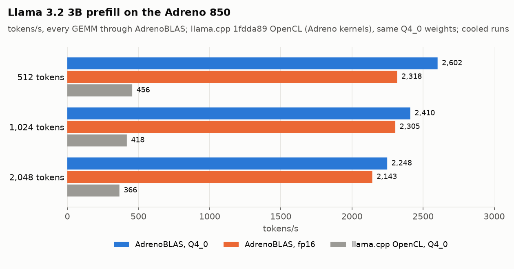
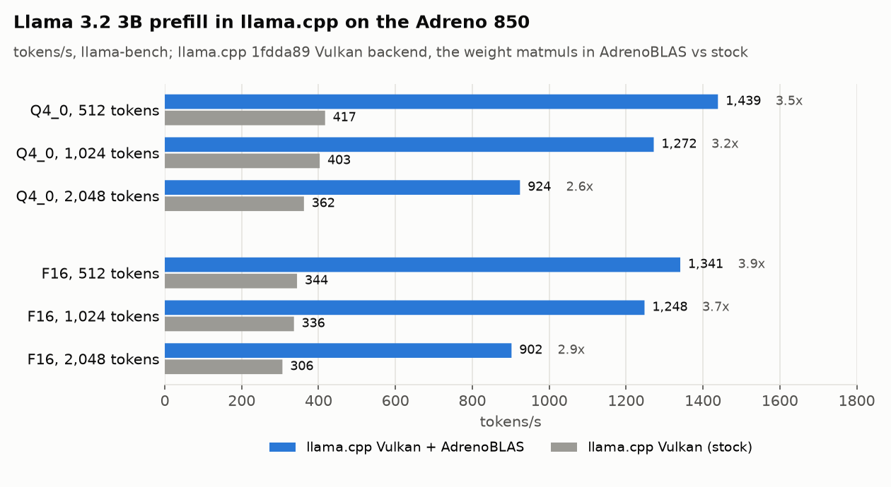
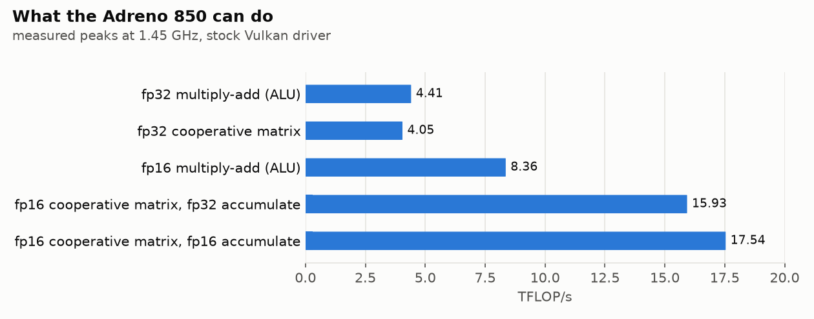
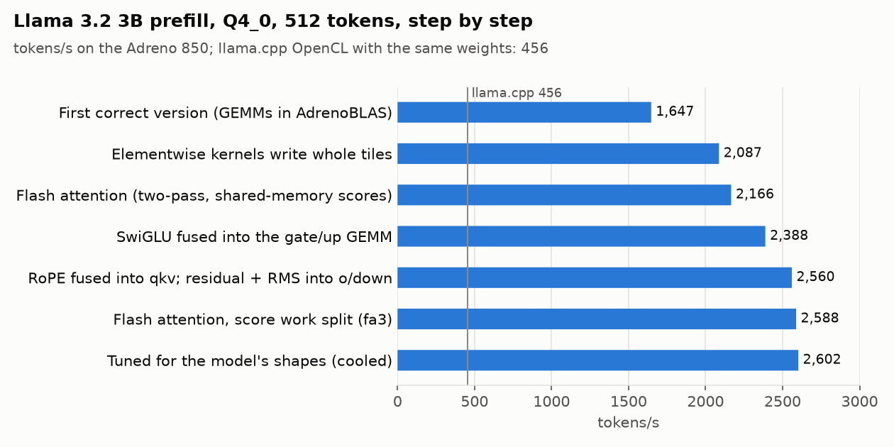

# AdrenoBLAS: fp16 GEMM at 97% of a Phone GPU's Matrix Peak, and Llama 3.2 3B Prefill at 2,600 Tokens/s

*Part 5 of [Bringing PyTorch LLMs to a Mid-Range Adreno GPU with IREE](https://github.com/adityaGoCT/iree-adreno-genai-tuner/blob/main/BLOG.md) (Part 4: [A Native GPU Target, and Llama Prefill on the Matrix Units](BLOG-COOPMAT.md)) · November 21, 2026 · Aditya*

## TL;DR

I set out to build a GEMM library for Adreno GPUs in the spirit of cuBLAS and rocBLAS, with one target: theoretical peak. A second question came with it: if the Vulkan driver's compiler can't get there, can hand-written assembly close the gap?

The target was an **Adreno 850** on a Qualcomm Device Cloud reference phone (SM8975, Android 17, 1.45 GHz). I measured its peaks first: 4.41 TFLOP/s for fp32, 8.36 for fp16 on the ALUs, and **17.5 TFLOP/s for fp16 on its matrix hardware**, which Vulkan exposes as cooperative matrices. The best fp16 GEMM I had at the start, a Mojo kernel tuned on the Adreno 840, ran at 4.25 TFLOP/s on it: 24% of that peak.

AdrenoBLAS now runs fp16 GEMM at **17.0 TFLOP/s at 4096 x 4096 x 8192 (97% of the matrix peak)**, 16.4 at 4096³ (93%) and 14.7 at 2048³ with operands in its packed tile format, and at 11.6 and 13.7 for operands as given. LLM prefill shapes run at 12.0 to 14.6 TFLOP/s with the weights packed once (13.9 to 16.2 with both operands packed), and all four operand layouts (NN, NT, TN, TT) are covered. Every call is checked against an fp32 reference on the phone. The library is a kernel generator, an on-device tuner, a catalogue builder and a 300-line C runtime.

Then I put a whole model on it. **Llama 3.2 3B prefills 512 tokens at 2,602 tokens/s with Q4_0 weights and 2,318 with fp16 weights** (2,248 and 2,143 at 2,048 tokens), with every matrix multiply in AdrenoBLAS. That is **5.7 to 6.1x llama.cpp's OpenCL backend** on the same phone with the same Q4_0 weights, and the output matches an fp32 reference (logits cosine 0.99993 or better, same top-1 token). The Q4_0 GEMM dequantizes 4-bit weights in registers straight into the matrix unit and runs at up to **17.7 TFLOP/s**, faster than fp16. That is more than the 17.5 my peak microbenchmark measured, so the true peak is likely about 17.8 (6,144 multiply-adds per clock). The whole Q4_0 prefill averages 15.2 TFLOP/s.

Then I put the library where most people run models: **inside llama.cpp**. A 370-line patch to llama.cpp's Vulkan backend sends every matrix multiply on a model weight to AdrenoBLAS and leaves the rest of llama.cpp alone. Llama 3.2 3B prefill becomes **3.5x faster with Q4_0 weights and 3.9x with F16** (1,439 and 1,341 tokens/s at 512 tokens, against 417 and 344 for stock llama.cpp). The output is identical to stock llama.cpp: same perplexity, same top token at every position, and the Q4_0 prefill GEMMs are bit-identical to its own. Getting there turned up a driver bug that has nothing to do with matrices (#13): mix push descriptors with ordinary descriptor sets in one command buffer and the driver silently gives every push-descriptor dispatch the last one's buffers.

On assembly: on the 850 it can be **read but not written**. The driver's compiled code sits in its pipeline cache and Mesa's disassembler decodes it, except four instruction words that drive the matrix unit. But a checksum rejects any edited code. On an Adreno 840 through Mesa's Turnip driver, hand-written assembly runs and beats both compilers' fp16 GEMM by about 10%; teaching its main trick to Turnip's register allocator recovers 5.0%.

Six lessons carried the most weight:

1. **On this GPU, layout is the kernel.** Each cooperative-matrix load wants long contiguous rows. A stored [K, M] beats A stored [M, K] by 1.3x at 2048³, and PyTorch's `Linear` layout runs at 2.4 TFLOP/s against 10.8. At 4096³, packing operands into contiguous tiles took the same kernel from 8.8 to 12.8 TFLOP/s, one 64 x 64 tile per subgroup took it to 15.3, and storing K contiguously inside each tile took it to 16.4.
2. **Benchmark the benchmark.** My first fp16 peak said 1,000 TFLOP/s, and my first matrix peak said 66. The compiler had deleted one loop and hoisted the other. Only kernels that load fresh data every iteration gave honest numbers.
3. **Map the driver, then route around it.** Twelve stock-driver bugs shaped the design: hangs, compiler crashes, wrong data and a 2x slowdown from Vulkan specialization constants. The generator never emits the bad patterns, and the runtime rewrites the SPIR-V it hands to the driver. One bug turned out narrower than it first looked, and routing around it was worth +28%.
4. **Read the machine code.** The last big step came from the driver's own statistics and a disassembly of the loop: 16 scalar 4-byte loads per step where 4 vector loads would do. Each matrix-unit lane holds one row of A and one column of B along K, so the tiles have to store K contiguously.
5. **A model is more than its GEMMs, and the matrix unit has a map.** The first correct Llama spent 40% of its time outside matrix multiplies. On the 850 each lane of the matrix unit owns one row of A, one column of B and one row of the result, so dequantization, softmax and activation work can stay inside a lane. But touching matrix elements directly costs about 20 clocks each; staging a tile through shared memory is the fast way, and fusing that work into each GEMM's epilogue removed most of the rest.
6. **A library inside someone else's program meets new bugs, theirs and the driver's.** In llama.cpp, AdrenoBLAS's push descriptors met llama.cpp's descriptor sets, and the driver mixed them up without an error. llama.cpp's tensor "addresses" turned out to be offsets that repeat across its memory buffers. A verify mode that runs both paths on every matrix multiply and compares them found both in an afternoon.

The code companion is [`ablas/`](ablas/) (the library), [`ablas/llama3b/`](ablas/llama3b/) (the Llama benchmark), [`ablas/llamacpp/`](ablas/llamacpp/) (the llama.cpp patch) and [`asm/`](asm/) (the peak and assembly probes) in this repo.






## The question: does a phone GPU need assembly to reach peak?

[Part 2](https://github.com/adityaGoCT/iree-adreno-genai-tuner/blob/main/BLOG-GEMM.md) tuned fp16 GEMMs for an Adreno 710 with a schedule search, a verifier and a cost model. [Part 4](BLOG-COOPMAT.md) taught Mojo the matrix hardware of the Adreno 840 and reached 3.7 TFLOP/s. Neither post asked how far from peak those kernels were, or whether the Vulkan path itself was the limit.

The plan had three steps:
1. Measure the real peak.
2. Find out whether hand-written assembly is even possible on these GPUs.
3. Build the library, with assembly where the compiler falls short.

A rented phone made one constraint concrete: Qualcomm Device Cloud sessions are time-limited, so everything had to run unattended from the Mac over an SSH-tunnelled adb.

## Step 1: Measure the peak, and don't trust the first number

The probes in [`asm/peak/`](asm/peak/) are generated GLSL compute shaders. Each runs a set of independent multiply-add chains, so the arithmetic units, not latency, set the speed:

```glsl
// gen_peak.py: CHAINS independent chains of width WIDTH, ITERS iterations
for (int i = 0; i < 512; ++i) {
  x0 = x0 * m + d;  x1 = x1 * m + d;  /* ... */  x31 = x31 * m + d;
}
float r = float(x0 + x1 + /* ... */ + x31);
if (r == 1234.0) c[gl_GlobalInvocationID.x] = r;   // keeps the loop alive
```

The harness is the one from Part 2 ([`vk_bench.c`](asm/peak/vk_bench.c)), extended to Vulkan 1.3 features and cooperative matrices. It times with GPU timestamps after a warm-up.

The first fp16 run reported **1,015,088 GFLOP/s**. Every variant took 33.8 µs. The guard read `r == 1234.5`, and 1234.5 needs 12 significant bits, which fp16 doesn't have. The compiler proved the store could never happen and deleted the whole loop. With a representable constant, fp16 peaks at 8.36 TFLOP/s, exactly twice fp32:

| measured on the Adreno 850 | TFLOP/s | theoretical at 1.45 GHz |
| --- | --- | --- |
| fp32 multiply-add | 4.41 | 4.45 (1,536 lanes) |
| fp16 multiply-add | 8.36 | 8.91 |

### The matrix units, and a hoisted loop

The 850's driver offers cooperative matrices for fp16 x fp16 into fp16 or fp32 (64 x {16, 32, 64} x 16), fp32 (K = 8) and int8 (K = 32). The fp16-into-fp32 shape is new: the 840 had no such shape. The obvious probe multiplies the same two tiles in a loop:

```glsl
for (int i = 0; i < 64; ++i) c0 = coopMatMulAdd(ma, mb, c0);
```

It reported **66 TFLOP/s**, 8x the ALU peak. The tell was in the timings. They grew with M x N but not with K, and fp16, fp32 and int8 all took the same time. The driver had computed `ma * mb` once and turned the loop into 64 matrix additions. Scaling A by a constant every iteration didn't help either, because the compiler factored the scale out. The only honest probe loads a fresh A tile from memory every iteration:

```glsl
for (uint i = 0; i < 64; ++i) {
  coopMatLoad(ma, a, ((base + i) & 31u) * 1024u, 16, gl_CooperativeMatrixLayoutRowMajor);
  c0 = coopMatMulAdd(ma, mb0, c0);
}
```



fp16 cooperative matrices sustain **17.5 TFLOP/s**: 2.1x the ALU peak, about 6,000 fp16 multiply-adds per clock. So the 850 has real matrix hardware. fp32 cooperative matrices run at ALU speed, so they don't use it. The results are also more accurate than a model that rounds every product and partial sum to fp16, about 3x lower error, while the 840's matched that model bit for bit. So the matrix unit accumulates in wider precision internally.

A sampled clock confirmed the GPU sat at 1.45 GHz for 34 of 40 samples during these runs. Against 17.5 TFLOP/s, the 4.25 of the 840-tuned Mojo kernel was 24%. The interesting question was where the other 76% went.

## Step 2: Can we write assembly for it?

There are two routes to hand-written assembly on Adreno.

**Mesa's Turnip driver** has a debug hook, `IR3_SHADER_OVERRIDE_PATH`. When a compiled shader's hash matches a `<hash>.asm` file in that directory, Turnip assembles the file and runs it instead. Mesa's device table knows the Adreno 840 but not the 850: Turnip refuses chip id `0x44051431`, and so did Mesa main on the day of writing.

**The stock driver** doesn't take assembly, but it does expose its output. `VK_KHR_pipeline_executable_properties` returns statistics without disassembly. Even the statistics told a story: a loop of 64 cooperative multiplies counts as just 32 fp32 and 1 fp16 ALU instructions, out of 190. The multiplies are a separate instruction class. The pipeline cache held the rest ([`isa/patch_cache.py`](asm/isa/patch_cache.py)):

```
32-byte Vulkan header, then entries:  key[8]  u32 size  u32 flag  { u32 raw_size  u32 1  zlib }
  entry 0: Qualcomm's LLVM 17 IR (intrinsics such as llvm.qgpu.coopmat.mul.v64f16.v64f16.v64f16)
  entry 1: the hardware shader: 0x50-byte header (magic b10bcace), sections, then the code
```

Mesa's disassembler, built for Android and run as `ir3-disasm -c 44050A31`, decodes almost all of entry 1. The loop body shows the A tile arriving through the texture path (`isam`). The multiply itself is four words Mesa has no encoding for:

```
106 isam.v.base0 (u32)(xyzw)r0.x, r1.x, s#0, t#0
107 isam.v.base0 (u32)(xyzw)r1.x, r1.x+4, s#0, t#0
...
109 82014200_00000220   unknown (cat4)
110 e6580000_00000000   unknown (cat7)
111 92405a00_01300200   unknown (cat4)
112 82215200_00000200   unknown (cat4)
```

So the code can be read. Can it be written? I patched the loop step in entry 1 so the loop would run half as many iterations, repacked the blob and seeded a new pipeline cache with it. The kernel's time didn't change. Timing pipeline creation showed why:

| pipeline cache seeded with | vkCreateComputePipelines |
| --- | --- |
| nothing | 104 ms (full compile) |
| the original blob | 0.6 ms (hit) |
| the blob unpacked and repacked, unchanged | 0.7 ms (hit) |
| any edit to the code | 100 ms (rejected, silently recompiled) |

A checksum in the entry header (word 9) covers the code. It isn't CRC32, CRC32C, Adler-32, FNV-1, FNV-1a, Murmur3 or xxHash32 over any range I tried. On the 850, assembly stops here for now.

### The 840 through Turnip: assembly works, and wins by 10%

A second session took the Turnip route on an Adreno 840 (a Galaxy Z Fold on Samsung's Remote Test Lab); details in [`asm/mesa/`](asm/mesa/). Turnip ran the 840 with no rebuild. An unchanged dump fed back through the hook round-trips with identical timing. Changing one loop increment halves the run time (8.68 to 4.36 ms), so the edited code really runs.

The 840 has no matrix unit: its cooperative-matrix path peaks at 7.35 TFLOP/s, below its 7.99 fp16 ALU peak. GEMM there is ALU code, which is exactly where hand-written assembly can help:

| fp16 GEMM, 2048³, Adreno 840 | TFLOP/s |
| --- | --- |
| hand-written assembly | **3.65** |
| stock driver's compiler (best kernel) | 3.39 |
| Turnip's compiler | 3.33 |

The win came from a register-file rule that Turnip's compiler doesn't respect (the stock compiler's code wasn't inspected). A multiply-add whose three register sources sit in the same bank issues at about one third of the rate. There are two banks, split by the parity of the register's scalar index: `.x` and `.z` in one, `.y` and `.w` in the other (for fp16, the low and high halves). Half the multiply-adds in Turnip's fp16 GEMM loops have that form. With the loads stripped out, the hand-written loop runs at 90% of peak against Turnip's 56%. End to end the gain shrinks to 10%, because the kernel then waits on operands. An 8 x 8 register tile at peak needs about 256 bytes per clock per SP, while the texture path delivers about 120 and shared memory about 107. Taught to Turnip's register allocator ([`asm/mesa/turnip-ra-bank.patch`](asm/mesa/turnip-ra-bank.patch)), the rule gives +5.0% geometric mean over 22 GEMM kernels, up to +21%, with every result still correct, once the allocator also accounts for the scheduler.

A small tuner for the 840 (`asm/mesa/tune_alu.py`) then picks, per kernel, between the stock compiler and Turnip with the allocator on or off. Turnip with the allocator wins three of four catalogue slots (fp16 at 2048³: 3.32 TFLOP/s against 3.14 for the best stock kernel); the stock compiler keeps fp32 at 512 x 2048 x 2048 (2.00). Per kernel the allocator ranges from -3.9% to +22.6%, which is why the choice is tuned rather than fixed.

### The verdict that shaped the library

On the 850 the matrix path is reachable from ordinary SPIR-V. The fresh-A probe shows the stock compiler sustaining 17.5 TFLOP/s in a tight loop. So the 76% gap of the starting kernel was not code generation. It was data movement: which tiles, in which layout, from which memory path. That can be fixed from SPIR-V, so AdrenoBLAS is built there. Assembly stays a research track: decoding the four matrix words, and the 840's bank rule, now a Turnip register-allocator patch.

## Step 3: A kernel template and an on-device sweep

[`ablas/gen.py`](ablas/gen.py) turns a configuration into a GLSL kernel. Each subgroup of 64 lanes owns `tm x tn` cooperative-matrix tiles of 64 x 32. Each workgroup holds `wm x wn` subgroups. The K loop loads one 64 x 16 A tile and `tn` 16 x 32 B tiles per step:

```python
dict(wm=2, wn=4, tm=1, tn=2, nt=32, acc="f16", ku=1, la="T", lb="N")  # -> BM = 128, BN = 256
```

```glsl
for (uint k = 0u; k < 2048u; k += 16u) {
  coopmat<float16_t, gl_ScopeSubgroup, 64, 16, gl_MatrixUseA> a0_0;
  coopMatLoad(a0_0, a, (k + 0u) * 2048u + (row0 + 0u), 2048, gl_CooperativeMatrixLayoutColumnMajor);
  coopmat<float16_t, gl_ScopeSubgroup, 16, 32, gl_MatrixUseB> b0_0;
  coopMatLoad(b0_0, b, (k + 0u) * 2048u + (col0 + 0u), 2048, gl_CooperativeMatrixLayoutRowMajor);
  coopmat<float16_t, gl_ScopeSubgroup, 16, 32, gl_MatrixUseB> b1_0;
  coopMatLoad(b1_0, b, (k + 0u) * 2048u + (col0 + 32u), 2048, gl_CooperativeMatrixLayoutRowMajor);
  c00 = coopMatMulAdd(a0_0, b0_0, c00);
  c01 = coopMatMulAdd(a0_0, b1_0, c01);
}
```

[`ablas/sweep.py`](ablas/sweep.py) builds every configuration for a shape, pushes them, and runs **each in its own process** on the phone. On this driver a bad kernel can segfault the compiler or hang the GPU, and that should cost one configuration, not the sweep. Each kernel's output is poisoned with NaNs, checked against an fp32 NumPy reference, and only then timed:

```
2048x2048x2048_NN: 40 configs
  gNN_w2x4_t1x2_n32_f16_k1                   8.17 TFLOP/s  err 5.7e-03  2103 us
  gNN_w1x4_t1x4_n32_f16_k1                   8.12 TFLOP/s  err 5.7e-03  2115 us
  ...
  gNN_w4x1_t1x1_n32_f16_k1                   0.70 TFLOP/s  err 5.7e-03  24590 us
```

The first sweep doubled the starting point, 4.25 to 8.17 TFLOP/s. It also had a clear pattern: one A tile per subgroup shared across two to four B tiles won, and two A tiles per subgroup always lost. In the NN layout an A tile is 64 rows of only 32 bytes, each in a different cache line.

## Step 4: Layout is the kernel

The generator already took layouts, so the test was one flag. A stored transposed, [K, M], turns the same 64 x 16 tile into 16 rows of 128 contiguous bytes. That alone lifted 2048³ to **10.8 TFLOP/s**. Sweeping all four layouts made the rule plain: the 850 wants both operands **K-major**.


The worst case is NT, which is how PyTorch stores a `Linear` weight ([N, K]) next to activations ([M, K]). Its B tiles become 32 columns of 32 bytes, and it runs at 2.4 TFLOP/s. The library therefore never runs NT directly: it packs NT operands first (Steps 6 and 8).

Several standard tricks did nothing or made things worse. Each was a sweep option, measured the same way:

| idea | result at 2048³ (TN, best config) |
| --- | --- |
| software prefetch (next step's loads before this step's multiplies) | 8.7 vs 10.8: the driver already hoists loads, and the extra registers cost occupancy |
| grouped workgroup order (Triton's `GROUP_M`) | 9.5 to 7.4 at 4096³ |
| 16-subgroup workgroups (1,024 threads) | 9.9 vs 10.8 |
| staging tiles through shared memory | 7.8: correct after a driver workaround, but a barrier every 16-wide K step |
| two K steps per iteration into alternating accumulators | 6.2 vs 8.8 for the same tile |

## Step 5: Map the driver's failure modes

Seven behaviours of this driver build (compiler E17.52.10.04) shaped the generator. Each was isolated with a small kernel:

| pattern | what happens | what AdrenoBLAS does |
| --- | --- | --- |
| two dependent `coopMatMulAdd` into one accumulator in a loop body (unrolling K) | GPU hang, `VK_ERROR_DEVICE_LOST` | one multiply per accumulator per iteration |
| adding two cooperative matrices (`c0 + c1`; also `ma + ma` on int8 tiles) | compiler segfault | never adds whole matrices; element-wise when needed |
| fp32 accumulator converted to fp16 for the store | compiler segfault | fp16 accumulation (wider inside the unit) |
| two or more 64-wide (N = 64) accumulators per subgroup | GPU hang | one 64 x 64 tile per subgroup (Step 8) |
| `coopMatLoad` from a `uint` or `uvec4` shared array | wrong data | `f16vec4` shared arrays |
| alternating accumulators with 4+ tiles | `vkCreateComputePipelines` returns -13 | not in the search space |
| M, N, K as specialization constants | 2x slower, and one kernel hangs | constants rewritten into the SPIR-V (Step 6) |

The shared-memory one shows how these were found. Staged kernels returned errors around 1.3, so the bug was somewhere in a three-step chain. Each diagnostic kernel copied a known tile out through one path:

| kernel ([`ablas/diag/`](ablas/diag/)) | result |
| --- | --- |
| global → shared (`uvec4`) → global, plain loads and stores | exact |
| `coopMatLoad` from global → `coopMatStore` | exact |
| global → shared (`uvec4`) → `coopMatLoad` → `coopMatStore` | **wrong** |
| same with `uint` shared array | **wrong** |
| same with `float16_t` or `f16vec4` shared array | exact |

The fix keeps the 128-bit global loads and writes them into an `f16vec4` array, two bitcasts per load.

Repros for all seven (eleven, with Step 11's), and an estimate of what each fix is worth, are in [`urgent_matter.md`](urgent_matter.md). The short version: one 64 x 64 tile per subgroup routed around most of the 64-wide hang (Step 8, +28% measured), and the unrolling hang and the two-tile hang are what remain between these kernels and the peak. Four more, all about touching individual matrix elements, turned up later in the Llama work (Step 11).

## Step 6: From kernels to a library

### The API

[`ablas/ablas.h`](ablas/ablas.h) follows cuBLAS conventions, with row-major storage as in PyTorch:

```c
ablas_handle h;
ablas_create(&h, physical_device, device, vkGetInstanceProcAddr, instance);
// C[M,N] = A * B, fp16. opA = T: A stored [K,M]; opB = T: B stored [N,K]; P: packed panels (Step 7)
ablas_hgemm(h, cmd, ABLAS_OP_N, ABLAS_OP_T, M, N, K,
            (ablas_buf){bufA, 0}, (ablas_buf){bufB, 0}, (ablas_buf){bufC, 0}, (ablas_buf){workspace, 0});
```

The call records into the application's command buffer, with push descriptors and no allocation. Kernel choice comes from a compiled-in catalogue, the way rocBLAS ships Tensile's logic files. [`build_lib.py`](ablas/build_lib.py) takes the fastest verified kernel for every tuned shape and layout from `results/`, plus a small fallback kernel per layout, and writes them as SPIR-V words into `ablas_kernels.h`. At run time the nearest tuned shape in log(M, N, K) whose tile divides the problem wins. An untuned 768 x 1536 x 1024 picked the 1024³ kernel and ran at 13.4 TFLOP/s.

### Specialization constants, and a SPIR-V rewrite

One SPIR-V module per kernel serves every shape when M, N and K are Vulkan specialization constants. Through the library, though, NN ran at half its tuned speed, and the 1024³ TN kernel hung the GPU. Running the tuning harness on the same kernels built three ways isolated the cause:

| kernel, 2048³ unless marked | specialization constants | rewritten to `OpConstant` | literals (tuning) |
| --- | --- | --- | --- |
| NN | 4,203 µs | **2,112 µs** | 2,123 µs |
| TN | 1,713 µs | **1,618 µs** | 1,777 µs |
| TT | 2,536 µs | **2,265 µs** | 2,272 µs |
| TN 1024³ | device lost | **179 µs** | 175 µs |

The driver handles real constants well and specialization constants badly. So the runtime specializes the SPIR-V itself before handing it over. It turns each `OpSpecConstant` with SpecId 0 to 2 into an `OpConstant` and drops the decoration, which is 30 lines of C:

```c
if (spec >= 0 && op == 71) continue;   // OpDecorate <id> SpecId <n>: drop it
if (spec >= 0 && op == 50) {           // OpSpecConstant <type> <id> <v> -> OpConstant <type> <id> <vals[n]>
  out[o++] = (4u << 16) | 43u; out[o++] = in[i + 1]; out[o++] = in[i + 2]; out[o++] = vals[spec];
  continue;
}
```

### Packing, and a transpose at the copy ceiling

Since TN is fastest, the runtime transposes other layouts into TN in a workspace. The first transpose, a 32 x 32 shared tile with scalar loads, moved data at 59 GB/s. [`ablas/transpose/`](ablas/transpose/) measured the alternatives against a plain 128-bit copy:

| 2048 x 2048 fp16 | GB/s |
| --- | --- |
| 128-bit copy (the ceiling) | 82.8 |
| 32 x 32 tile, scalar loads and stores | 58.5 |
| 8 x 8 block per thread, transposed in registers | 14.9 to 19.5 |
| **64 x 64 tile, 128-bit loads and stores** | **79.3** |

The register transpose looked best on paper and was worst in practice: each thread's 16-byte stores land in eight different output rows. The 64 x 64 tile writes 128-byte runs and gets within 4% of the copy. With it, packing pays for B whenever it is stored [N, K] (TT 1024³: 9.4 packed vs 7.7 direct), and for A from 2³¹ multiply-adds up (NN 1024³ is faster direct: 10.1 vs 9.2).

## Step 7: Fixing 4096³ with panels

TN fell from 10.8 TFLOP/s at 2048³ to 8.8 to 9.5 at 4096³. Volume was not the reason. The compulsory traffic at 4096³ is 96 MB, 1.2 ms at 83 GB/s, against a 15.6 ms runtime. Bigger workgroup tiles, which cut traffic further, were slower, and grouped ordering was worse.

The access pattern is what changes with size. At 4096 a row is 8 KB, so each 64 x 16 A tile spans 16 rows over 128 KB of address space. That touches more pages and cache sets than the same tile at 2048.

The standard BLAS answer is panels: store every tile a cooperative load reads as one contiguous block, with consecutive K tiles adjacent. A becomes `[M/64][K/16][16][64]` (each tile 2 KB) and B becomes `[N/32][K/16][16][32]` (each tile 1 KB). Each load is then a 2 KB or 1 KB contiguous read, and a subgroup's K loop walks memory sequentially:

```glsl
// layout "P": tile (m/64, k/16) of A starts at ((m/64) * (K/16) + k/16) * 1024, stride 64 inside
coopMatLoad(a0_0, a, (((row0 + 0u) / 64u) * (4096u / 16u) + (k + 0u) / 16u) * 1024u, 64,
            gl_CooperativeMatrixLayoutColumnMajor);
```

| kernel layout | 4096³ | 2048³ |
| --- | --- | --- |
| TN (K-major rows) | 9.37 | 10.81 |
| **panels** | **12.49** | **11.38** |

Panels made 4096³ faster than 2048³. Nine different tile configurations landed between 11.1 and 12.5 TFLOP/s, so the layout, not one lucky configuration, did the work. In the library, panels are a fourth operand kind, `ABLAS_OP_P`. `ablas_pack_a` and `ablas_pack_b` pack an operand once: K-major sources go through a 128-bit re-tiling copy, and the others are transposed straight into panels. That's the path for LLM weights. For GEMMs of 2³⁵ multiply-adds and up, the runtime also packs unpacked operands into panels on the fly.

## Step 8: One 64 x 64 tile per subgroup

The bug table above first said 64-wide tiles hang the GPU. That came from the peak probe, which keeps B in registers across iterations, and I had extrapolated it to GEMM without testing. A sweep with `--nt 64` at 2048³ (TN) told a narrower story: all 8 configurations with **one** 64 x 64 accumulator per subgroup passed, and all 16 with **two** lost the device. The best single-tile kernel ran at 11.40 TFLOP/s against 10.81 for the best 64 x 32 kernel.

A 64 x 64 tile is what the load arithmetic asked for: one A load and one B load per multiply, the ratio at which the probe sustained 17.5 TFLOP/s. Its B tile is 16 x 64, so B rows become 128 bytes, the change that was worth 1.3x for A in Step 4. To give those tiles contiguous storage too, B panels became 64 wide, `[N/64][K/16][16][64]` (layout `Q`; 32-wide tiles read it as half a panel row):

```glsl
// layout "Q": tile (k/16, n/64) of B starts at ((n/64) * (K/16) + k/16) * 1024, stride 64 inside
coopMatLoad(b0_0, b, (((col0 + 0u) / 64u) * (2048u / 16u) + (k + 0u) / 16u) * 1024u + (col0 + 0u) % 64u, 64,
            gl_CooperativeMatrixLayoutRowMajor);
```

| kernel (tuning harness, TFLOP/s) | 2048³ | 4096³ |
| --- | --- | --- |
| TN, 64 x 32 tiles | 10.81 | 9.37 |
| panels, 64 x 32 tiles | 11.38 | 12.49 |
| **panels, one 64 x 64 tile per subgroup** | **13.82** | **14.12** |

Every 64 x 64 configuration beat every 64 x 32 one. Against the TN kernel the library used before, 2048³ gained 28%, the low end of the +20 to 35% that [`urgent_matter.md`](urgent_matter.md) had estimated from load ratios. In the library, `ablas_pack_b` now writes 64-wide panels, and NT calls from 2³¹ multiply-adds go to panels, since they transpose both operands on either path (NT 2048³: 10.1 vs 8.7 TFLOP/s).

## Step 9: Read the loop, then fix the tiles

With one 64 x 64 tile per subgroup, the ratio of loads to multiplies already matched the 17.5 TFLOP/s probe, so I asked the driver what it had compiled. Its statistics reported 132 instructions, a footprint of 17 vector registers and 21% ALU occupancy. The loop body, dumped from the pipeline cache and run through Mesa's disassembler ([`asm/isa/dump/pq_code.dis`](asm/isa/dump/pq_code.dis)), showed where the time went:

```
ldib.b.untyped.1d.u32.1.uniform.base0 r0.x, r2.x, r1.w      x 8: one operand, 4 bytes per lane each
isam.v.base0 (u32)(x)r2.x, r3.w, s#0, t#0                    x 8: the other operand, 4 bytes each
92408a00_01000108                                             the 64 x 64 x 16 multiply
```

That is sixteen scalar 4-byte loads per step. Each lane of the matrix unit holds one row of A and one column of B along K. The panels from Step 7 stored K outside each tile, so a lane's 16 halves sat 128 bytes apart and the compiler fetched them one at a time. Storing K contiguously inside each tile (A tiles row-major, B tiles column-major; layouts `R` and `C`) puts each lane's 32 bytes side by side ([`rc_code.dis`](asm/isa/dump/rc_code.dis)):

```
ldib.b.untyped.1d.u32.4.uniform.base0 r0.x, r1.y, r1.x      x 2: 16 bytes per lane each
isam.v.base0 (u32)(xyzw)r2.x, r3.x, s#0, t#0                 x 2
92408a00_02000208
```

Four vector loads instead of sixteen scalar ones, and a 16-instruction loop instead of 30. Tuned with the GPU cooled before every configuration (`sweep.py --cool`):

| shape (operands packed, TFLOP/s) | 64-wide panels | K contiguous inside tiles |
| --- | --- | --- |
| 4096³ | 15.83 | **16.55** (95%) |
| 2048³ | 13.82 | **14.83** |
| 512 x 8192 x 2048 / 2048 x 512 x 2048 | 13.26 / 15.22 | **15.28 / 15.69** |

The format also suits PyTorch. In a `Linear` layer, activations [M, K] and weights [N, K] already have K contiguous, so packing them is a plain re-tiling copy with no transpose ([`tile_copy.comp`](ablas/tile_copy.comp)). That copy has to write in runs. Walking K along whole rows scattered 32-byte writes over K/16 tiles and ran at 28 GB/s. Copying 32-row x 64-K blocks writes 256-byte runs, and took the 512 x 2048 x 8192 LLM shape (weights pre-packed) from 10.5 to 13.5 TFLOP/s. Software prefetch, tried once more on the new tiles, was still slower (15.6 vs 16.55).

## Step 10: What's left is the store

Efficiency now rises with K: the same kernel runs at 16.35 TFLOP/s at 4096³, **16.99 at 4096 x 4096 x 8192 (97%)** and 16.82 at 4096 x 4096 x 16384, through the library. So the inner loop runs at about 97% of peak, and what is left at 4096³ is a fixed cost per output tile. Most of it is the store of C: 32 MB, about 0.4 ms of an 8.3 ms run, issued by every workgroup at the same moment, so it overlaps no matrix work.

| idea at 4096³ (tuning, cooled, TFLOP/s) | result |
| --- | --- |
| baseline, one 64 x 64 tile per subgroup | **16.67** |
| K unrolled by 2 / 4 (one 64 x 64 accumulator: no hang, unlike 64 x 32 tiles) | 15.53 / 14.29 |
| 16-subgroup workgroups, grouped workgroup order | 14.1 at best |
| persistent workgroups, 2 to 16 output tiles each | 5.4 to 7.5 |

Persistent workgroups are the usual way to hide that store: each workgroup loops over several output tiles, so one tile's store overlaps the next tile's K loop. On this driver they ran 3x slower, although the disassembly ([`ps2_code.dis`](asm/isa/dump/ps2_code.dis)) shows the same 17-instruction inner loop as the fast kernel. That one stays open.

## Step 11: A whole model: Llama 3.2 3B prefill

Near-peak GEMMs raise the next question: what do they buy in a real model? I built a prefill benchmark for Llama 3.2 3B ([`ablas/llama3b/`](ablas/llama3b/)) in which every matrix multiply goes through AdrenoBLAS, in two weight formats:
- **fp16.**
- **Q4_0**: 4-bit values in blocks of 32 with an fp16 scale each, the format llama.cpp's Adreno kernels are tuned for.

The setup:
- **One command buffer** runs all 28 layers, the LM head on the last token included, with no CPU work in between.
- **Weights are packed once**, offline. Every activation is written by the kernel that produces it directly in the format the next GEMM reads, so nothing gets packed at run time.
- **An fp32 reference checks every result.** It is built from transformers' own `LlamaDecoderLayer` and uses the same rounded or quantized weights. The Mac's 17 GB can't hold the model in fp32, so it loads one layer at a time.

The first correct version prefilled 512 tokens in 311 ms (1,647 tokens/s). Its GEMMs already ran at 16 to 17 TFLOP/s, and 40% of the time went elsewhere. Six steps took it to 197 ms:



### The matrix unit has a map

Vulkan leaves open which lane of a subgroup holds which element of a cooperative matrix. A probe ([`probe/map.comp`](ablas/llama3b/probe/map.comp)) loads matrices of known values and prints every lane's elements. On the 850 the layout is as regular as it gets:
- a 16 x 64 B matrix holds output column n in lane n, with k in element k;
- a 64 x 16 A matrix holds row r in lane r;
- a 64 x 64 accumulator holds row r in lane r, with column e in element e.

Step 9 had inferred the first two from the load instructions. The third means a lane owns a whole row of each output tile.

### Q4_0 in registers

With B laid out by column, a lane can dequantize its own column of weights. Each 16-deep step:
- Each lane loads 8 bytes of 4-bit values plus its column's scale.
- It builds two halves at a time: `((w >> 4j) & 0x000F000F) | 0x64006400` reinterpreted as fp16 is 1024 + q, subtracting 1032 is exact, and multiplying by the scale rounds once.
- It writes the 16 values into the B matrix element by element.

No shared memory is involved. The first version ran 2048³ at 15.5 TFLOP/s, above the fp16 kernel's 14.8. Weights stream at 0.56 bytes each instead of 2, which more than pays for the dequantizing.

It also returned an error of 0.25, and finding out why turned up two more driver bugs:
- Writing elements into a matrix that was never initialized crashes the compiler.
- A constant-index write to element 4 of a B matrix is silently dropped. Elements 0 to 3 and 5 to 15 arrive. An identity-matrix test showed exactly one missing k per 16, and an index the compiler can't fold fixed it.

### Writing whole tiles

RMSNorm, SiLU and RoPE first used one thread per row segment. Each wrote 32-byte pieces 2 KB apart into the packed tiles, so they ran at about a third of memory bandwidth: the scattered-write problem again, from `tile_copy` in Step 9. Giving each subgroup one 2 KB tile, with lane = row, took the prefill from 311 to 245 ms.

### Elements are slow; shared memory is fast

The accumulator map invites a flash attention in which a lane runs the softmax over its own row of scores. The first version did that through element access, and it ran slower than the three separate kernels it replaced (24 vs 21 ms at 512 tokens). Removing parts one at a time found the cause:
- Reading or rewriting an accumulator element costs about 20 clocks.
- Rescaling the output once per key block took 7 of 11.4 ms per layer at 2,048 tokens.
- Multiplying the matrix by a per-lane scalar instead was slower still (23.6 ms).

The working version stores each score tile to padded shared memory with `coopMatStore`, and each lane reads its row back as ordinary vectors. Two passes avoid rescaling the output entirely:
1. The first pass collects each row's maximum and sum.
2. The second writes normalized probabilities back to shared memory, where `coopMatLoad` turns them into the A operand of P·V.

Two 64-wide accumulators per subgroup would hang (bug #4), so each 128-wide head is split across two subgroups. The final version has those subgroups take alternate key blocks and share their probability tiles, instead of both computing every block. It runs a layer at 2,048 tokens in 4.5 ms, against 17.3 ms for the separate kernels. Two more compiler crashes surfaced:
- reading accumulator elements with constant indices into a vector;
- matrix multiplies under a branch that differs between subgroups.

Every multiply now runs unconditionally: the subgroup without a block multiplies zeros.

### Fused epilogues

The same staging works at the end of a GEMM. The library gained `ablas_hgemm_ex` with three epilogues:
- **SwiGLU** on the gate/up projection, with gate and up weights interleaved 32 rows at a time. It writes silu(gate) · up directly in the packed format of the down projection's input. This removes a pass, and the GEMM writes half as much, so it got faster: 17.5 TFLOP/s.
- **RoPE** in the qkv projection, which writes Q and K per head and V transposed, ready for attention. RoPE pairs dimensions d and d + 64, so the weight rows of each Q and K head are permuted to [0, 64, 1, 65, ...] at load time. A pair then sits in one lane, and Q·Kᵀ doesn't change because Q and K get the same permutation.
- **Residual + RMS statistics** on the o and down projections. They add into the fp32 residual stream and write each row's partial sum of squares, so RMSNorm shrinks to one pass that writes tiles. This one barely pays: the extra fp32 reads and writes cost about as much as the separate pass did (198 vs 201 ms at 512 tokens, 894 vs 908 ms at 2,048).

### Tuning for the model's shapes

The catalogue had been tuned on square shapes. [`sweep_llm.py`](ablas/sweep_llm.py) tunes both kernel families, with and without each epilogue, on the model's projections at 512, 1,024 and 2,048 tokens. Each shape's configurations run in one on-device loop, because every adb call through the tunnel costs 2.5 s. Three findings:
- **Some choices were badly off.** fp16's down projection had been getting a tile that runs at 14.9 TFLOP/s, against 17.3 for the best.
- **Some 4-subgroup epilogue tiles run at half speed at some shapes** (8.6 vs 16.9 TFLOP/s), so epilogues get their own tuning entries.
- **The Q4_0 gate/up projection with SwiGLU ran at 17.73 TFLOP/s** at 2,048 tokens. That beats the 17.5 the peak microbenchmark measured in Step 1. At 1.45 GHz it means at least 6,114 multiply-adds per clock, most likely 6,144, for a theoretical peak of about 17.8 TFLOP/s.

### The result

| tokens/s (cooled, best of 3) | 512 tokens | 1,024 | 2,048 |
| --- | --- | --- | --- |
| **AdrenoBLAS, Q4_0** | **2,602** | **2,410** | **2,248** |
| **AdrenoBLAS, fp16** | **2,318** | **2,305** | **2,143** |
| llama.cpp OpenCL (Adreno kernels), same Q4_0 weights | 456 | 418 | 366 |

The baseline is llama.cpp at `1fdda89` on the same phone, under the same thermal gate, at its fastest setting: micro-batch 512, no flash attention. Its F16 model doesn't fit next to Android in the phone's 11 GB: the process is killed for memory with every load mode.

The device output matches the fp32 reference at 512 and 2,048 tokens in both formats:
- last-token logits cosine 0.99993 or better;
- the same top-1 token;
- KL divergence at most 8e-4;
- mean hidden-state cosine 0.99993.

One token's hidden state is chaotic: a one-in-a-million change to RMSNorm's epsilon moves it between 0.993 and 0.9998 in every pipeline variant. It is also the most noise-sensitive row in the fp32 reference itself.

At 2,048 tokens, GEMMs are 80% of the time. They run at 14 to 17 TFLOP/s inside the model, against 17.1 to 17.7 in isolation, because the model keeps the GPU busy, and hotter, for a whole second. Attention takes 15% of the time and normalization 4%. The whole Q4_0 prefill averages 15.2 TFLOP/s at 512 tokens: 87% of the measured matrix peak, model and all.

## Step 12: Inside llama.cpp

A benchmark runtime shows what the hardware can do; most people run models through llama.cpp. So the next question was how much of the speed survives inside it if AdrenoBLAS replaces only llama.cpp's matrix multiplies and everything else stays llama.cpp's: attention, normalization, RoPE, the KV cache, sampling.

### The patch

llama.cpp's Vulkan backend (ggml-vulkan, at `1fdda89`) already runs on the 850, on the same matrix units, at 417 tokens/s for Q4_0. The patch hooks its matrix multiply: when the weight is a `blk.*.weight` in F16 or Q4_0, the call goes to AdrenoBLAS. ggml hands over fp32 activations and expects fp32 results, so the library got three new calls:
- `ablas_pack_a_f32` converts the fp32 input to packed fp16 tiles, rows padded to 64;
- `ablas_q4_0_pack_ggml` converts ggml's `block_q4_0` weights to AdrenoBLAS's Q4_0 layout on the GPU;
- `ablas_gemm_f32out` runs the GEMM with a new epilogue that writes fp32 rows straight into ggml's output tensor, only the M real rows.

Weights are repacked once, on first use. Q4_0 weights get a repacked copy (1.6 GB extra), so decode, at one row per matrix multiply, keeps llama.cpp's mat-vec kernels on the original. F16 weights are repacked in place, because a copy of 5.6 GB doesn't fit. The query, key and value projections read the same input, and so do gate and up, so each input is packed once. The fp32-output epilogue got its own tuning entries: before tuning, the kernels it picked ran at 8.5 to 15 TFLOP/s; after, 14 to 17 for Q4_0 and 11 to 16 for fp16.

### Bug 13: push descriptors next to descriptor sets

The first run printed "888888...". A verify mode, which runs each matrix multiply through both AdrenoBLAS and llama.cpp and compares them, found most AdrenoBLAS results exactly zero. Every one was right when it ran alone, and the last AdrenoBLAS dispatch in each command buffer was right.

AdrenoBLAS passes its buffers with push descriptors, which are recorded into the command buffer with each dispatch. llama.cpp binds ordinary descriptor sets. With a llama.cpp-style dispatch between AdrenoBLAS's, every push-descriptor dispatch in the command buffer ran with the descriptors pushed last. A one-line shader shows it: three dispatches that add `tag * 65536 + i` into three buffers leave the first two at 0 and the third at 6 x 65,536 + i (1 + 2 + 3). Each dispatch's push constants were its own; only the buffers were wrong. Without the dispatches in between, all three buffers are right. Binding the other pipeline and its set without dispatching doesn't trigger it.

This affects any library that uses push descriptors inside a program that doesn't, and it fails silently. AdrenoBLAS now has a descriptor-set mode, `ablas_use_descriptor_sets`: one ordinary set per dispatch from its own pools, freed when llama.cpp cleans up after a graph. It costs nothing measurable. The repro is #13 in [`driver_bugs/`](driver_bugs/).

### An address that isn't one

Q4_0 now matched llama.cpp exactly. F16 still produced nonsense. Verify mode showed layers 0 to 22 right, and every weight of layer 23 repacked into values that appeared nowhere in that weight. The cause was mine. I keyed "already repacked" weights by the tensor's data pointer, but ggml-vulkan gives every device buffer the same fake base address. The 6.4 GB F16 model is spread over buffers of about 1 GB each. Layer 23 sat in the sixth at the same offset as layer 2 in the second, so it got layer 2's weights. The 1.8 GB Q4_0 model had no such collision. Weights are now keyed by (buffer, offset).

### The result

| llama-bench, tokens/s | 512 tokens | 1,024 | 2,048 | decode |
| --- | --- | --- | --- | --- |
| **llama.cpp Vulkan + AdrenoBLAS, Q4_0** | **1,439** | **1,272** | **924** | 30.7 |
| llama.cpp Vulkan, Q4_0 | 417 | 403 | 362 | 29.5 |
| **llama.cpp Vulkan + AdrenoBLAS, F16** | **1,341** | **1,248** | **902** | 10.9 |
| llama.cpp Vulkan, F16 | 344 | 336 | 306 | 10.9 |

That is 3.5x (Q4_0) and 3.9x (F16) at 512 tokens, falling to 2.6x and 2.9x at 2,048. Unlike its OpenCL backend, llama.cpp's Vulkan backend loads the F16 model on this phone. Every test started with the GPU at or below 45 °C and no thermal cap; repeat runs that evening agreed within 5%. Decode doesn't change: one token at a time is limited by memory bandwidth in both builds.

The answers don't change either:
- **Q4_0:** perplexity 31.3109 vs 31.3116 on this repo's blog posts (8 x 512 tokens). The top token is the same at every position. The prefill GEMMs are bit-identical to llama.cpp's: both multiply fp16 operands into fp16 accumulators on the same matrix units, in the same k order.
- **F16:** perplexity 29.5491 vs 29.5496, same top token everywhere.
- **Text:** greedy continuations match stock llama.cpp token for token, for a short prompt and a 900-token one.

Inside llama.cpp the Q4_0 prefill runs at 1,439 tokens/s, against 2,602 in AdrenoBLAS's own runtime. The difference is everything that isn't a GEMM:
- **At 512 tokens:** the GEMMs take about 190 ms of the 356 and packing activations about 20 (timed in isolation). llama.cpp's normalization, RoPE, SwiGLU, residual adds, KV-cache writes and the barriers between them take the other ~150 ms. The own runtime fuses those into the GEMM epilogues.
- **At 2,048 tokens:** llama.cpp's flash attention runs at about 1 TFLOP/s on this GPU and takes a third of the time, in the stock build and the patched one alike.

Both are fixable inside llama.cpp, and they are the next steps.

## Results

Measured through the library with [`ablas_test`](ablas/ablas_test.c), one shape at a time with [`cool_run.sh`](ablas/cool_run.sh), which waits for the GPU to cool to 45 °C with no thermal cap first. Timing uses GPU timestamps, warm-up, then the best of five runs of back-to-back calls. Every call was checked against an fp32 CPU reference on 1,024 sampled elements. The percentage is the share of the measured 17.5 TFLOP/s peak. "Pre-packed" operands went through `ablas_pack_a`/`ablas_pack_b` once, before the timed calls.

| call (layout, M x N x K) | TFLOP/s | of peak |
| --- | --- | --- |
| pre-packed, 4096 x 4096 x 8192 / 4096 x 4096 x 16384 | **16.99** / 16.82 | **97%** / 96% |
| pre-packed, 4096³ | 16.36 | 93% |
| TN / NT / NN input, 4096³ (packed in the call) | 13.71 / 13.56 / 13.76 | 77-79% |
| pre-packed, 2048³ | 14.71 | 84% |
| TN / NN / TT / NT input, 2048³ | 11.63 / 9.71 / 9.72 / 10.72 | 55-66% |
| pre-packed, 1024³ | 13.41 | 77% |
| LLM prefill, both pre-packed: 512 x 2048 x 2048 / 512 x 8192 x 2048 / 512 x 2048 x 8192 | 13.91 / 15.17 / 16.20 | 79-93% |
| LLM prefill, weights pre-packed (activations as given): same shapes | 11.98 / 14.59 / 13.49 | 68-83% |

A second QDC phone unit, after the Llama work changed the runtime, passed the same checks and ran pre-packed 4096³ at 16.69 TFLOP/s (95%) and 4096 x 4096 x 8192 at 16.95.

Q4_0 weights and the fused epilogues at Llama 3.2 3B's projection shapes (isolated kernels from `sweep_llm.py`, M = 512 / 2,048, TFLOP/s; model results in Step 11):

| projection (N x K) | fp16 | Q4_0 |
| --- | --- | --- |
| qkv 5120 x 3072 | 15.8 / 16.6 | 16.3 / 17.1 |
| gate+up 16384 x 3072, SwiGLU epilogue | 17.0 / 16.8 | **17.7 / 17.7** |
| down 3072 x 8192 (plain; residual epilogue) | 17.3 / 17.4; 15.9 / 15.6 | 17.5 / 17.6; 16.3 / 16.2 |
| o 3072 x 3072 (plain; residual epilogue) | 16.7 / 16.7; 13.7 / 12.7 | 17.0 / 17.3; 14.2 / 15.0 |
| LM head 128256 x 3072, M = 64 | 4.8 (memory bound) | 15.1 |

Shapes must be multiples of 64 (M) and 32 (N and K); the packed path needs M, N and K to be multiples of 64, and other shapes fall back to the unpacked kernels. New shapes compile their pipeline in about 150 ms on first use. Accuracy follows the 850's fp16 accumulation: relative error 3e-3 to 1e-2 of the largest output against fp32, growing with K.

## What did not work

| attempt | outcome |
| --- | --- |
| injecting edited machine code through the 850's pipeline cache | rejected by a content checksum; the driver silently recompiles |
| Turnip on the 850 | chip id `0x44051431` unknown to Mesa, including Mesa main |
| unrolling K, or K chunks of 32 in shared memory | GPU hang (two multiplies into one accumulator per iteration) |
| alternating accumulators to allow unrolling | correct, but 6.2 vs 8.8 TFLOP/s, and pipelines fail at 4+ tiles |
| fp32 accumulation | compiler segfault on the fp32 → fp16 conversion |
| shared-memory staging | slower than direct loads (7.8 vs 10.8) once correct |
| software prefetch, grouped order, 1,024-thread workgroups | all slower |
| a register-only transpose | 15-20 GB/s: scattered 16-byte stores |
| two 64 x 64 accumulators per subgroup (64 x 128 of C) | GPU hang |
| persistent workgroups (several output tiles each) | 3x slower on this driver, same inner loop |
| K unrolled with one 64 x 64 accumulator | correct, but 15.5 / 14.3 vs 16.7 TFLOP/s |
| softmax and rescaling through accumulator element access | ~20 clocks per element: slower than three separate kernels |
| rescaling an accumulator with a matrix-times-scalar | slower still (23.6 vs 11.4 ms per attention layer) |
| fusing the residual add into the o/down GEMMs | correct; only 1.5% faster overall (fp32 traffic moves into the GEMM) |
| llama.cpp's flash attention or micro-batch 2048, for the OpenCL baseline | slower than its defaults on this phone |
| AdrenoBLAS's push descriptors inside llama.cpp | most GEMMs wrote into the last GEMM's output (driver bug #13); ordinary descriptor sets work |
| keying repacked weights by ggml's tensor data pointer | the pointer repeats across buffers: F16 layer 23 got layer 2's weights |
| larger micro-batches for llama.cpp + AdrenoBLAS at 2,048 tokens | 916-937 tokens/s at 512, 1,024 and 2,048: attention, not the GEMMs, sets the pace |
| llama.cpp Vulkan without flash attention (`-fa 0`) | segfaults on this phone, in stock llama.cpp too |

## Measuring on a phone you rent by the hour

The Qualcomm Device Cloud phone is reached through an SSH tunnel to the session host's adb server. On the Mac that means `ADB_SERVER_SOCKET='tcp:[::1]:5037'`, with a second phone on Samsung's Remote Test Lab on the ordinary adb server at the same time. The phone has a root shell, which made three things easy:

- **Clock checks.** Sampling `/sys/class/kgsl/kgsl-3d0/gpuclk` during a run put the GPU at its 1.45 GHz top clock for 34 of 40 samples. A peak measured at a lower clock would understate every percentage in this post.
- **Crash isolation.** One configuration per process, in a shell loop on the phone. A kernel that loses the device costs one line of results.
- **Driver archaeology.** The pipeline-cache blobs and Mesa's disassembler run on the phone itself, so nothing large crosses the tunnel.
- **Thermal checks.** After about 40 minutes of sweeps the phone capped the GPU at 636 to 1,126 MHz, and a library run came out up to 2x low. [`cool_run.sh`](ablas/cool_run.sh) now runs one shape at a time and waits until the GPU (`gpuss-0`) is at most 45 °C with no thermal cap, and `sweep.py --cool` does the same before every tuning configuration.

The tunnel pushed data at 4 to 9 MB/s. Shape data for 4096³ is 128 MB with its reference, so each new shape cost about 30 seconds of push before any GPU time. The Llama weights are 1.8 GB (Q4_0) and 6.4 GB (fp16): 25 minutes of upload, repeated in full because the phone is wiped between sessions. A session also ended mid-sweep, about three and a half hours in; the tunnel stayed up and every connection was reset. The tuner now writes no result file when nothing ran, so a rerun picks up where it stopped. Every adb call through the tunnel costs about 2.5 s, so the LLM tuner pushes all of a shape's kernels at once and runs them in one shell loop on the phone.

## Reproduce it

```bash
export ADB_SERVER_SOCKET='tcp:[::1]:5037' ANDROID_SERIAL=<serial>   # QDC tunnel; plain adb works for a local phone
NDK_CC=$ANDROID_NDK/toolchains/llvm/prebuilt/darwin-x86_64/bin/aarch64-linux-android34-clang
VK=<vulkan headers>   # e.g. third_party/iree/third_party/vulkan_headers/include

# peaks
cd asm/peak && $NDK_CC -O2 -I$VK -o vk_gemm_bench vk_bench.c -ldl -lm
python3 gen_peak.py && python3 run_peak.py stock
python3 gen_coopmat_load.py && ./run_list.sh manifest_cml.txt spv_cml/variants.txt 2048

# tune, build the catalogue, run the library
cd ../../ablas
python3 sweep.py 2048 2048 2048 --la T --lb N      # one shape and layout; results/ and kernels/
python3 sweep.py 4096 4096 4096 --la R --lb C --nt 64 --cool   # K-contiguous tiles, 64 x 64 per subgroup
python3 build_lib.py                                # results/ -> ablas_kernels.h
$NDK_CC -O2 -I$VK -o build/ablas_test ablas_test.c ablas.c -ldl -lm
adb push build/ablas_test cool_run.sh /data/local/tmp/ablas/
adb shell 'cd /data/local/tmp/ablas && ./cool_run.sh "P P 4096 4096 4096" "T N 2048 2048 2048"'
```

```bash
# Llama 3.2 3B prefill (ablas/llama3b/README.md has the details)
cd ablas && python3 sweep_llm.py q4 512,2048 5120:3072,3072:3072:a,16384:3072:g,3072:8192:a && python3 build_lib.py
cd llama3b && python export.py q4 && python export.py f16 && python ref.py tokens && python ref.py q4 512
./build.sh && adb push llama3b vkrun bench.sh ref/tokens.bin /data/local/tmp/l3b/   # + kernels/ and weights/
adb shell "cd /data/local/tmp/l3b && ./llama3b -w w/llama3b_q4 -m 512 -p -o out"      # per-op profile, dumps
python ref.py cmp q4 512 out                                                          # after adb pull of out/
adb shell "cd /data/local/tmp/l3b && ./bench.sh 'q4 512' 'q4 2048' 'f16 512' 'f16 2048'"
```

```bash
# llama.cpp + AdrenoBLAS (ablas/llamacpp/README.md has the details)
cd ~/llama.cpp && git checkout 1fdda89 && git apply <this repo>/ablas/llamacpp/adrenoblas-ggml-vulkan.patch
LLAMA=~/llama.cpp <this repo>/ablas/llamacpp/build.sh              # stock and AdrenoBLAS builds for Android
adb push build-android-vulkan/bin-stripped/* /data/local/tmp/lcpp/vk_stock/   # likewise -ablas -> vk_ablas/
adb shell "cd /data/local/tmp/lcpp && ./vkbench.sh vk_ablas Llama-3.2-3B-Instruct-Q4_0-pure.gguf 'pp512 pp2048 tg32'"
```

`ablas_test P P 4096 4096 4096 T N 2048 2048 2048 ...` runs any list of shapes. `P` operands are packed once with `ablas_pack_a`/`ablas_pack_b` before the timed calls.

## What's next

- **The last 3 to 5%.** At 4096³ it is the store of C, issued by every workgroup at once; at K = 8192 the library is at 97%. Persistent workgroups would hide the store but run 3x slower on this driver, so the next step is finding out why: same inner loop, very different speed.
- **Packing per call.** Operands as given lose 15-20% at 4096³ (13.7 vs 16.4) to packing. For LLM activations this is solved: the epilogues write each output straight into the next GEMM's tile format.
- **Attention at long prompts:** 15% of the prefill at 2,048 tokens. A single-pass flash attention needs a cheap rescale of the output accumulator; on this driver that has to go through shared memory, and the output tile won't fit next to the probability tiles yet.
- **fp32 accumulation**, by converting through the shared-memory epilogue staging instead of the conversion that crashes the compiler.
- **Edges and batches:** shapes that aren't tile multiples, and strided-batched GEMM in the library (attention is model code today).
- **More of llama.cpp:** AdrenoBLAS's flash attention in place of llama.cpp's (5.4 TFLOP/s against about 1 at long prompts), and the own runtime's fusions (gate/up with SwiGLU, o and down with the residual add, RoPE into qkv) as graph-level fusions in ggml-vulkan. Together they should close most of the gap between 1,439 and 2,602 tokens/s.
- **Decode:** batch-1 GEMV for Q4_0 and fp16 and a KV cache, where the matrix units don't help and memory bandwidth (83 GB/s here) decides.
- **The Adreno 840:** the ALU backend is in the library (up to 3.64 TFLOP/s with Turnip); the register-allocator patch (+5.0%) goes upstream to Mesa.
