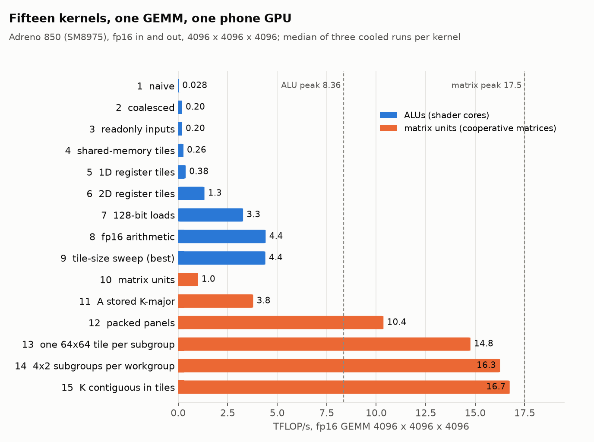

# How to Optimize a GEMM for a Phone GPU: an Adreno 850 Worklog

*A companion to [Part 5: AdrenoBLAS](BLOG-ABLAS.md) · November 22, 2026 · Aditya*

In 2022 Simon Boehm wrote [a worklog](https://siboehm.com/articles/22/CUDA-MMM) of ten CUDA kernels for one matrix
multiply, each a small change to the last, from a naive kernel to within a few percent of cuBLAS. It is still the
best way I know to learn how a GPU really spends its time. This post does the same on a phone: an **Adreno 850**, the GPU in Qualcomm's
SM8975, running a fp16 GEMM of 4096 x 4096 x 4096 through Vulkan compute shaders on the stock Android driver.

Fifteen kernels take it from **0.028 TFLOP/s to 16.7 TFLOP/s**, 600 times faster and 96% of the 17.5 TFLOP/s the
GPU's matrix hardware sustains in a microbenchmark. The first nine kernels follow the classic recipe on the
shader ALUs: coalescing, shared memory, register tiles, wide loads, fp16 math. They stop at about half of the ALU
peak. The last six move to the matrix units through `VK_KHR_cooperative_matrix`, where the problem turns out to be
almost entirely about how the operands are laid out in memory.

Some of the CUDA intuitions transfer and some don't. Shared memory alone buys little here; at sizes that fit in
cache it is slower than no shared memory at all. `readonly` doesn't change a single instruction. And the first
matrix-unit kernel is slower than the last ALU kernel.

| kernel | TFLOP/s | vs previous | % of matrix peak (17.5) |
| --- | ---: | ---: | ---: |
| 1: naive | 0.028 | | 0.2% |
| 2: coalesced | 0.197 | 7.0x | 1.1% |
| 3: inputs `readonly` | 0.197 | 1.0x | 1.1% |
| 4: shared-memory tiles | 0.261 | 1.3x | 1.5% |
| 5: 1D register tiles | 0.375 | 1.4x | 2.1% |
| 6: 2D register tiles | 1.33 | 3.5x | 7.6% |
| 7: 128-bit loads | 3.28 | 2.5x | 19% |
| 8: fp16 arithmetic | 4.42 | 1.35x | 25% |
| 9: tile-size sweep | 4.40 | 1.0x | 25% |
| 10: matrix units (cooperative matrices) | 1.00 | 0.23x | 5.7% |
| 11: A stored K-major | 3.79 | 3.8x | 22% |
| 12: packed panels | 10.4 | 2.7x | 59% |
| 13: one 64 x 64 tile per subgroup | 14.8 | 1.4x | 84% |
| 14: several subgroups per workgroup | 16.3 | 1.10x | 93% |
| 15: K contiguous inside each tile | 16.7 | 1.03x | 96% |



Every kernel is a short GLSL compute shader in [`gemm_worklog/kernels/`](gemm_worklog/kernels/). Every number
above is the median of three cooled runs on one phone with [`gemm_worklog/`](gemm_worklog/), and every result
was first checked against a double-precision reference.

## The setup

**The phone** is a Qualcomm Device Cloud reference device: SM8975, Adreno 850, Android 17, the stock Vulkan driver
(compiler E17.52.10.04, Vulkan 1.4), GPU clock 1.45 GHz.

**The problem** is C = A B with M = N = K = 4096, fp16 in and fp16 out: 137.4 GFLOP. A is [M, K] and B is [K, N],
both row-major, unless a kernel says otherwise. Kernels 11 to 15 want their operands in other layouts; the
harness stores them that way before the run, the way a library packs a weight matrix once (more on that cost
later).

**The harness** ([`bench.c`](gemm_worklog/bench.c)) fills A and B with random fp16 values in [-1, 1), runs the
kernel once, and compares 1,024 sampled outputs with a double-precision dot product. Only then does it time
the kernel with GPU timestamps: the best of 5 runs of back-to-back dispatches. M, N and K are compiled into each
shader as constants. On this driver, passing them as Vulkan specialization constants instead makes some kernels
2x slower ([Part 5](BLOG-ABLAS.md#specialization-constants-and-a-spir-v-rewrite) has the details).

**The phone gets hot.** Under sustained load the Adreno 850 throttles, and a throttled run can come out at half
speed. So [`run.sh`](gemm_worklog/run.sh) waits before every kernel until the GPU is below 45 °C with no thermal
cap, and samples the clock while it runs. It also waits while any other benchmark is running on the phone. The
table reports the median of three interleaved rounds (each round runs every kernel once). The rounds agreed within
1% for 13 of the 15 kernels; kernel 11 varied by up to 15% and kernel 8 by 3%.

## What the hardware offers

[Part 5](BLOG-ABLAS.md#step-1-measure-the-peak-and-dont-trust-the-first-number) measured the peaks with
microbenchmarks:

| Adreno 850, measured | |
| --- | --- |
| fp32 multiply-add on the ALUs | 4.41 TFLOP/s (1,536 lanes at 1.45 GHz: 4.45) |
| fp16 multiply-add on the ALUs | 8.36 TFLOP/s (twice fp32) |
| fp16 on the matrix units (cooperative matrices) | 17.5 TFLOP/s |
| memory: a 128-bit copy | 83 GB/s |

A few more facts shape the kernels. A subgroup (warp) has 64 lanes. A workgroup can have up to 1,024 threads and
32 KB of shared memory. And the driver exposes `VK_KHR_pipeline_executable_properties`, which reports, for every
compiled kernel, its instruction counts by class, its register footprint and its occupancy. I will use those
statistics to explain what each change did.

A roofline check: the GEMM does 137.4 GFLOP and must move at least 96 MiB (A, B and C once each). At 83 GB/s that
is 1.2 ms, and at 17.5 TFLOP/s the arithmetic takes 7.9 ms. So with good reuse of data on chip this GEMM is
compute-bound by a wide margin. Every kernel below is really a different answer to the question of where the
data waits between its trip from memory and its multiply.

## Kernel 1: naive

One thread per output, with an fp32 accumulator:

```glsl
layout(local_size_x = 64, local_size_y = 4) in;
void main() {
  uint row = gl_GlobalInvocationID.x, col = gl_GlobalInvocationID.y;
  float acc = 0.0;
  for (uint k = 0u; k < K; ++k) acc += float(a[row * K + k]) * float(b[k * N + col]);
  c[row * N + col] = float16_t(acc);
}
```

`gl_GlobalInvocationID.x` walks the rows, so the 64 lanes of a subgroup take 64 rows of one column. Each K step,
their 64 loads of A hit 64 different rows, 8 KB apart. Their load of B is one address shared by all 64, and their
stores at the end are 8 KB apart again.

It runs at **0.028 TFLOP/s**: five seconds for one GEMM. It also showed the first phone-specific obstacle. Run
as a single dispatch, it never finished: after a couple of seconds the GPU's management unit logged `gpu timeout`,
the kernel driver dumped the GPU state, and the Vulkan device was lost. Android's GPU watchdog treats any
submission that runs that long as a hang. The harness now splits a long dispatch into eight separately submitted
slices (`vkCmdDispatchBase`) and adds up their times.

## Kernel 2: coalescing

Swap the two indices, so x walks the columns:

```glsl
uint col = gl_GlobalInvocationID.x, row = gl_GlobalInvocationID.y;
```

Now the 64 lanes of a subgroup read one contiguous 128-byte run of a B row per K step, and their A load is a
single address that all lanes share. Their stores are contiguous too. **0.197 TFLOP/s, 7x.**

In a quick (uncooled) run at 1024³ the same kernel ran at 0.55 TFLOP/s. There the matrices are 2 MB each; at
4096³ they are 32 MB each, and far less of the reuse is caught by the caches.

## Kernel 3: `readonly`

In CUDA, marking the inputs `const __restrict__` lets the compiler use the read-only data cache, and that often
pays. The Vulkan equivalent is `readonly restrict`. Here it changed nothing: 0.197 TFLOP/s. The driver's statistics say why: both versions compile to
the same 87 instructions, with **8 texture reads and no ordinary memory reads**. The compiler had already
noticed that the shader never writes A or B and sent their loads through the texture pipe. The pipeline
statistics are the quickest way to find out what you actually got.

## Kernel 4: shared-memory tiles

The classic next step: a 32 x 32 workgroup computes a 32 x 32 block of C. Each K step, every thread copies one
element of A and one of B into shared memory, and then all 32 threads of a row or column reuse it:

```glsl
shared float16_t As[T][T], Bs[T][T];
for (uint k0 = 0u; k0 < K; k0 += T) {
  As[ty][tx] = a[row * K + k0 + tx];
  Bs[ty][tx] = b[(k0 + ty) * N + col];
  memoryBarrierShared();
  barrier();
  for (uint k = 0u; k < T; ++k) acc += float(As[ty][k]) * float(Bs[k][tx]);
  barrier();
}
```

Global traffic drops 32x. The kernel gets only 1.3x faster: **0.261 TFLOP/s** (16 x 16 tiles: 0.211). The
compiled loop shows why the gain is small: 64 shared-memory loads for 32 multiply-adds. Each multiply-add now
needs two loads from shared memory, so the loop trades waiting on the texture cache for waiting on shared
memory. At 1024³, where the matrices are 2 MB each and the caches catch more of the reuse, this kernel was even
*slower* than kernel 2 in the same quick run: 0.26 against 0.55 TFLOP/s. On this GPU the texture cache already provides a good part of
what shared memory is meant to.

## Kernel 5: 1D register tiling

To get more than one multiply-add out of each shared-memory load, a thread computes several outputs. Here a
workgroup of 512 threads covers a 64 x 64 block, and each thread computes 8 outputs down one column. Each B value
it reads from shared memory serves eight multiply-adds:

```glsl
for (uint k = 0u; k < BK; ++k) {
  float bv = float(Bs[k * BN + tcol]);
  for (uint i = 0u; i < TM; ++i) acc[i] += float(As[(trow * TM + i) * BK + k]) * bv;
}
```

**0.375 TFLOP/s, 1.4x.** Every A value is still loaded once per multiply-add.

## Kernel 6: 2D register tiling

Now each thread computes an 8 x 8 sub-block of a 128 x 128 block: per K step it loads 8 values of A and 8 of B
into registers and does 64 multiply-adds with them, four per load:

```glsl
for (uint k = 0u; k < BK; ++k) {
  for (uint i = 0u; i < TM; ++i) ra[i] = float(As[(tr * TM + i) * BK + k]);
  for (uint j = 0u; j < TN; ++j) rb[j] = float(Bs[k * BN + tc * TN + j]);
  for (uint i = 0u; i < TM; ++i)
    for (uint j = 0u; j < TN; ++j) acc[i * TN + j] += ra[i] * rb[j];
}
```

**1.33 TFLOP/s, 3.5x**, the biggest step of the ALU half. The statistics show the price: with 64 fp32
accumulators plus the fragments, the driver reports a register footprint of 23 full-precision and 45
half-precision registers, and occupancy falls from 100% to 15%. Fewer threads in flight are enough now, because
each one has far more independent work.

## Kernel 7: 128-bit loads

Kernel 6 still moves data in 2-byte pieces. Kernel 7 moves it 16 bytes at a time:
- every global load is a `uvec4`, 8 halves;
- the A tile is stored *transposed* in shared memory, so a thread's 8 rows of A sit next to each other like its
  8 columns of B;
- both fragments are read as `f16vec4`;
- C is written as `uvec4`.

```glsl
shared f16vec4 As[BK * BM / 4u];   // As[k][m]: transposed
...
for (uint k = 0u; k < BK; ++k) {
  for (uint i = 0u; i < TM / 4u; ++i) ra[i] = vec4(As[k * (BM / 4u) + tr * (TM / 4u) + i]);
  for (uint j = 0u; j < TN / 4u; ++j) rb[j] = vec4(Bs[k * (BN / 4u) + tc * (TN / 4u) + j]);
  for (uint i = 0u; i < TM; ++i)
    for (uint j = 0u; j < TN / 4u; ++j) acc[i][j] += ra[i / 4u][i % 4u] * rb[j];
}
```

**3.28 TFLOP/s, 2.5x.** The loop is now mostly arithmetic. Of its 1,523 instructions, 1,172 are 32-bit ALU
operations: the multiply-adds, plus the conversions from fp16 to fp32.

## Kernel 8: fp16 arithmetic

The ALUs do twice as many multiply-adds per clock in fp16 as in fp32, two per lane. Keeping the accumulators, the
fragments and every multiply-add in `f16vec4` uses that, and drops the conversions:

```glsl
acc[i][j] = fma(f16vec4(ra[i / 4u][i % 4u]), rb[j], acc[i][j]);
```

**4.42 TFLOP/s, 1.35x.** The loop now counts 1,024 16-bit ALU instructions and only 148 32-bit ones, and with
half-size accumulators occupancy rises from 18% to 25%. The price is accuracy: summing 4,096 products in fp16
raises the maximum error from 2.4e-4 to 1.4e-2 of the largest output. That is a real cost for a GEMM this deep.

## Kernel 9: a tile-size sweep

Kernel 8's tile sizes are compile-time parameters, so a sweep over 15 configurations is a loop in
[`build.py`](gemm_worklog/build.py). One run of the sweep:

| block (BM x BN x BK), per-thread tile | TFLOP/s |
| --- | ---: |
| **64 x 128 x 16, 8 x 8** | **4.41** |
| 128 x 128 x 16, 8 x 8 (kernel 8) | 4.38 |
| 128 x 256 x 16, 8 x 8 | 4.25 |
| 128 x 128 x 16, 8 x 16 | 4.00 |
| 128 x 128 x 32, 8 x 8 | 3.71 |
| 128 x 128 x 8, 8 x 8 | 2.69 |
| 128 x 64 x 16, 8 x 8 | 1.59 |
| 256 x 256 x 16, 16 x 16 | 0.09 (registers spill) |

In that run 64 x 128 came out 1% ahead of kernel 8's 128 x 128. Across three rounds the two are the same: 4.40
against 4.42 TFLOP/s. So the sweep found nothing better than the configuration chosen by reasoning. What it does
show is how narrow the good region is: halving BK, swapping BM and BN, or one step too many registers costs
from 40% to 98%. **About 4.4 TFLOP/s is 53% of the fp16 ALU peak.** Getting further on the ALUs means fighting
operand bandwidth: an 8 x 8 register tile at peak needs more bytes per clock than shared memory or the texture
path deliver. On the Adreno 840, hand-written assembly that respects a register-bank rule bought about 10% more
([Part 5](BLOG-ABLAS.md#the-840-through-turnip-assembly-works-and-wins-by-10)). On the 850 there is a much
bigger lever.

## Kernel 10: the matrix units

The 850 has matrix hardware, and Vulkan exposes it as cooperative matrices: a subgroup loads tiles of A and B as
opaque objects and multiplies them in one operation, 64 x 16 times 16 x 32 (or 16 x 64) on this driver. Each
subgroup computes a 64 x 32 block of C:

```glsl
coopmat<float16_t, gl_ScopeSubgroup, 64, 32, gl_MatrixUseAccumulator> acc = ...(0.0);
for (uint k = 0u; k < K; k += 16u) {
  coopmat<float16_t, gl_ScopeSubgroup, 64, 16, gl_MatrixUseA> ma;
  coopmat<float16_t, gl_ScopeSubgroup, 16, 32, gl_MatrixUseB> mb;
  coopMatLoad(ma, a, row0 * K + k, K, gl_CooperativeMatrixLayoutRowMajor);
  coopMatLoad(mb, b, k * N + col0, N, gl_CooperativeMatrixLayoutRowMajor);
  acc = coopMatMulAdd(ma, mb, acc);
}
coopMatStore(acc, c, row0 * N + col0, N, gl_CooperativeMatrixLayoutRowMajor);
```

The accumulator is fp16. The matrix unit keeps more precision inside, so the result is still more accurate than
kernel 8's: 5.4e-3 against 1.4e-2. (fp32 accumulators peak lower on this GPU, 15.9 TFLOP/s, and this driver gets
the conversion of one to fp16 for the store wrong.)

This kernel is the shortest so far, and it runs at **1.00 TFLOP/s**, a quarter of kernel 9. The matrix unit is
starved. Its A tile is 64 rows of 32 bytes, each row in a different place in memory, 8 KB apart.

## Kernel 11: A stored K-major

If A is stored transposed, as [K, M], the same 64 x 16 tile becomes 16 runs of 128 contiguous bytes. Only the
load changes:

```glsl
coopMatLoad(ma, a, k * M + row0, M, gl_CooperativeMatrixLayoutColumnMajor);   // A stored [K, M]
```

**3.79 TFLOP/s, 3.8x.** Even with the same bytes, the number of separate runs a tile load touches matters a lot.

## Kernel 12: packed panels

So take it to its end: store every tile a load reads as one contiguous block. A becomes `[M/64][K/16]` tiles of
64 x 16 (2 KB each), B becomes `[N/32][K/16]` tiles of 16 x 32 (1 KB), and the K tiles of one panel sit next to
each other. A subgroup's K loop now reads memory sequentially:

```glsl
uint pa = (row0 / 64u) * (K / 16u) * 1024u, pb = (col0 / 32u) * (K / 16u) * 512u;   // panel starts
for (uint k = 0u; k < K; k += 16u) {
  coopMatLoad(ma, a, pa + (k / 16u) * 1024u, 64, gl_CooperativeMatrixLayoutColumnMajor);   // one 2 KB block
  coopMatLoad(mb, b, pb + (k / 16u) * 512u, 32, gl_CooperativeMatrixLayoutRowMajor);       // one 1 KB block
  acc = coopMatMulAdd(ma, mb, acc);
}
```

**10.4 TFLOP/s, 2.7x.** In a library this is a one-time cost for a weight matrix. For an activation, the packing
copy runs at about 79 GB/s, so packing A at this size would add roughly 0.8 ms to an 8 ms GEMM.

Here are the A layouts side by side:

| A tile (64 x 16 fp16) stored as | contiguous runs per tile | lane's 16 K values |
| --- | --- | --- |
| [M, K] row-major (kernel 10) | 64 runs of 32 B, 8 KB apart | adjacent |
| [K, M] (kernel 11) | 16 runs of 128 B, 8 KB apart | 128 B apart |
| panels, column-major tiles (kernels 12-14) | one 2 KB block | 128 B apart |
| panels, row-major tiles (kernel 15) | one 2 KB block | adjacent |

The last column becomes important in kernel 15.

## Kernel 13: one 64 x 64 tile per subgroup

The driver offers B tiles 64 wide too. With 16 x 64 B tiles (in 64-wide panels), each K step is one 2 KB load of A,
one 2 KB load of B and a 64 x 64 x 16 multiply: twice the arithmetic per byte loaded.

```glsl
coopmat<float16_t, gl_ScopeSubgroup, 64, 64, gl_MatrixUseAccumulator> acc = ...(0.0);
...
  coopmat<float16_t, gl_ScopeSubgroup, 16, 64, gl_MatrixUseB> mb;
  coopMatLoad(mb, b, pb + (k / 16u) * 1024u, 64, gl_CooperativeMatrixLayoutRowMajor);
```

**14.8 TFLOP/s, 1.4x.** One warning from this driver: **two** 64 x 64 accumulators per subgroup hang the GPU. One is fine.

## Kernel 14: several subgroups per workgroup

So far every workgroup was a single subgroup. With WM x WN subgroups per workgroup, each still computing one
64 x 64 tile, a workgroup covers a (64 WM) x (64 WN) block of C. The idea: a workgroup runs on one core, so
subgroups in the same row read the same A panel at about the same time from the same cache, and subgroups in
the same column the same B panel. A sweep:

| subgroups per workgroup (M x N) | 1 x 2 | 2 x 1 | 2 x 2 | 1 x 4 | 4 x 1 | 2 x 4 | **4 x 2** | 4 x 4 |
| --- | --- | --- | --- | --- | --- | --- | --- | --- |
| TFLOP/s | 10.5 | 14.2 | 15.9 | 15.0 | 13.9 | 15.8 | **16.1** | 15.6 |

**16.3 TFLOP/s with 4 x 2** (median of three; the single sweep run above measured 16.1). Shape matters, and not
symmetrically: 1 x 2 is slower than a single subgroup.

## Kernel 15: K contiguous inside each tile

Kernel 14's compiled loop has **8 texture reads** for its two tile loads per K step. [Part 5](BLOG-ABLAS.md#step-9-read-the-loop-then-fix-the-tiles)
disassembled the same kind of loop and found narrow scalar loads. On the 850, each lane of the matrix unit holds
one row of A and one column of B along K. In a column-major A tile, a lane's 16 halves sit 128 bytes apart, so the
compiler fetches them piece by piece.

Storing A tiles row-major and B tiles column-major puts each lane's 32 bytes side by side. Only the strides and
two layout flags change:

```glsl
coopMatLoad(ma, a, pa + (k / 16u) * 1024u, 16, gl_CooperativeMatrixLayoutRowMajor);      // row r: 16 adjacent halves
coopMatLoad(mb, b, pb + (k / 16u) * 1024u, 16, gl_CooperativeMatrixLayoutColumnMajor);   // column n: 16 adjacent halves
```

The loop now has **2 texture reads** instead of 8, and 2 x 2 subgroups per workgroup win: **16.7 TFLOP/s, 96%
of the measured matrix peak.** With one subgroup per workgroup the same change gains nothing (14.6 against
14.8). My reading is that a lone subgroup is limited by something else, and the extra load instructions only
start to cost once four subgroups share a core.

This kernel is the one AdrenoBLAS's tuner picked for this shape. Its generated version
([`ablas/gen.py`](ablas/gen.py), configuration `gRC_w2x2_t1x1_n64`) runs at the same speed in this harness:
16.77 TFLOP/s.

## What's left

The last 4% is mostly the store of C. The inner loop already runs near peak: through the library, the same kernel
reaches 97% at 4096 x 4096 x 8192, where each output tile does twice the work per store. At 4096³ every
workgroup writes its 32 KB of C at about the same moment, and nothing overlaps that burst. Persistent
workgroups, the usual cure, ran 3x slower on this driver even though their inner loop compiles to the same
instructions. The obvious remaining tricks either didn't help or hung the GPU
([Part 5](BLOG-ABLAS.md#what-did-not-work) has the list):
- software prefetch;
- K unrolling into two accumulators;
- staging the tiles through shared memory;
- grouped workgroup order.

## What carried over from CUDA, and what didn't

1. **Coalescing** carries over unchanged: a 64-lane subgroup wants its 64 loads to be one contiguous run (7x).
2. **Register tiling and wide loads** carry over too: after coalescing, kernels 6 and 7 were the two biggest
   steps on the ALUs.
3. **Shared memory alone** buys much less than on NVIDIA GPUs. The texture cache already catches a lot of the
   reuse, and at sizes that fit in cache a shared-memory kernel was slower than none.
4. **`readonly` and similar hints** may do nothing. The pipeline statistics show what you got.
5. **On the matrix units, layout is the kernel.** From kernel 10 to 15 the arithmetic never changed: one
   cooperative multiply per K step. The 17x came from where the operands live and how a load reaches them.
6. **A phone is a hostile benchmark host.** It throttles, so each kernel starts cool. Its GPU watchdog kills a
   submission after a couple of seconds. And other work on the phone shows up in the numbers, so the runner
   waits for it, and the table reports medians.

## Reproduce

```bash
cd gemm_worklog
python3 build.py 4096        # SPIR-V for every kernel and sweep point (glslc), and the harness (Android NDK)
adb shell mkdir -p /data/local/tmp/worklog/spv
adb push build/bench build/runlist.txt run.sh /data/local/tmp/worklog/
adb push build/spv/. /data/local/tmp/worklog/spv/
adb shell "cd /data/local/tmp/worklog && ./run.sh 4096"   # every kernel, cooled; ~45 min
python3 plot.py              # the chart, from results/
```

One kernel by hand: `./bench spv/15_kminor_2x2.spv 4096 4096 4096 32 32 R C` (grid 32 x 32, A layout R, B layout C).

## Further reading

- Simon Boehm, [How to Optimize a CUDA Matmul Kernel for cuBLAS-like Performance: a Worklog](https://siboehm.com/articles/22/CUDA-MMM), the model for this post.
- [Part 5: AdrenoBLAS](BLOG-ABLAS.md): how these kernels became a library, the eleven driver bugs found along the
  way, the attempt at hand-written assembly, and Llama 3.2 3B prefill at 2,600 tokens/s on the same phone.
- [`gemm_worklog/README.md`](gemm_worklog/README.md): the files, the layouts and the raw results.
