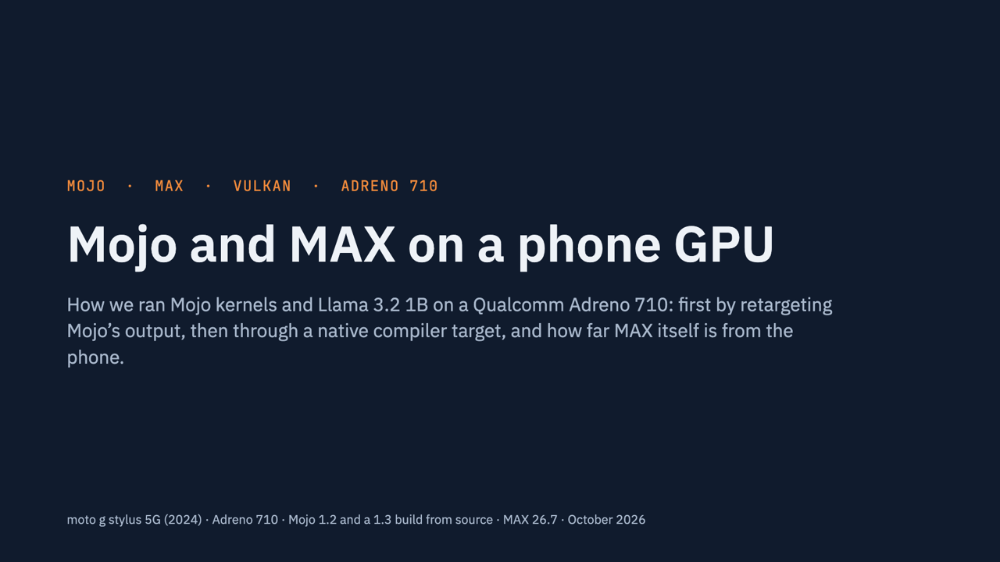

# mojo-adreno

Run Mojo GPU kernels on a phone's **Adreno 710** GPU, even though Mojo has no target for it.

Mojo 1.2 (Modular) has GPU targets for NVIDIA, AMD and Apple only: no SPIR-V, Vulkan, OpenCL or
Adreno. This repo gets ordinary Mojo GPU code (MAX `gpu` module, `global_idx`, `DeviceContext`)
running on the Adreno 710 of a moto g stylus 5G (2024) anyway, by taking the kernel from **Mojo's own
LLVM IR** and retargeting it. Mojo compiles the kernel for an AMD CDNA2 GPU (`gfx90a`), whose 64-lane
warps match the Adreno's subgroups; the IR then goes to Vulkan SPIR-V or OpenCL C. One command, four
verified backends:

```
$ python3 mojo_adreno.py src/vecadd_gpu.mojo
summary: turnip=PASS  stock=PASS  opencl=PASS  cpu=PASS
```

Write-up, code first: **[Running Mojo GPU Kernels on an Adreno Phone GPU](BLOG.md)**. Demo:
**[Llama 3.2 1B generating text on the phone with Mojo kernels](llama/README.md)** (48 of 48 tokens
identical to PyTorch; 3.5 tokens/s on both the stock driver and Mesa Turnip). It is Part 3 of a
series whose Parts 1 and 2 (PyTorch → IREE → Adreno, and an fp16 GEMM tuner) live in
[adityaGoCT/iree-adreno-genai-tuner](https://github.com/adityaGoCT/iree-adreno-genai-tuner).

Part 4: **[A Native GPU Target, and Llama Prefill on the Matrix Units](BLOG-COOPMAT.md)**: Mojo's own
Vulkan SPIR-V target, KHR cooperative matrices from Mojo, and Llama 3.2 1B on a Snapdragon 8 Elite Gen 5
(Adreno 840): a 431-token prompt in 1.29 s on the matrix units instead of 17.3 s, decode at 41 ms/token.

Since Mojo's compiler went open source (August 2026), there is a second route: a prototype
`adreno710` target inside the compiler itself, in
[adityaGoCT/modular, branch `adreno-spirv-target`](https://github.com/adityaGoCT/modular/tree/adreno-spirv-target),
compiles the same kernels and Llama straight to Vulkan SPIR-V, with no retargeter. See
[Native SPIR-V target](#native-spir-v-target).

Presentation: **[Mojo and MAX on Adreno](docs/presentation/mojo-and-max-on-adreno.pdf)** (26 slides,
PDF), the whole experiment from the retargeter to the native target and a compile-only test of MAX
graphs. [View it online](https://claude.ai/artifact/9HodHBDh22HuBYoo5UxTN6) (slides with speaker
notes, in the browser), or as an [HTML slide viewer](docs/presentation/mojo-and-max-on-adreno.html)
(download and open it; ←/→ to move, N for notes) with [speaker notes](docs/presentation/mojo-and-max-on-adreno-speaker-notes.md).

[](docs/presentation/mojo-and-max-on-adreno.pdf)

| backend | path |
|---|---|
| `turnip` | Mojo IR → `opt -O3` → `mojo2vk.py` → LLVM 22 SPIR-V backend (SPIR-V 1.6) → Vulkan 1.3 on Mesa Turnip |
| `stock` | same, SPIR-V 1.4 + `VK_KHR_spirv_1_4`, int64 narrowed to int32 → Qualcomm Vulkan 1.1 driver |
| `opencl` | Mojo IR → `mojo2cl.py` → OpenCL C → Qualcomm OpenCL 3.0 compiler on the phone |
| `cpu` | `mojo build --emit object --target-triple aarch64-unknown-linux-android34` → NDK link |

| kernel (`src/`) | exercises | turnip | stock | opencl | cpu |
|---|---|---|---|---|---|
| `vecadd_gpu` | the basics, n = 1,000,003 | PASS | PASS | PASS | PASS |
| `vecadd4_gpu` | a loop, phis | PASS | PASS | PASS | (same CPU kernel) |
| `warpsum_gpu` | MAX `warp.sum`: warp shuffles | PASS | PASS | PASS | n/a |
| `blocksum_gpu` | shared memory + barriers: a tree reduction per 64-thread block | PASS | PASS | PASS | n/a |
| `matmul_naive_gpu` | 1024 × 1024 SGEMM from global memory | PASS | PASS | PASS | n/a |
| `matmul_tiled_gpu` | 1024 × 1024 SGEMM, 16 × 16 tiles staged through shared memory | PASS | PASS | PASS | n/a |
| `matmul_tiled_f16_gpu` | the same with fp16 tiles in shared memory (fp32 accumulation) | PASS | PASS | PASS | n/a |
| `matmul_regtile_gpu` | 1024 × 1024 SGEMM, 128 × 128 workgroup tiles, 8 × 8 outputs per thread in registers | PASS | PASS | PASS | n/a |

0 mismatches everywhere; every output element is checked on the phone. All of it passes with
`--accel gfx90a` (default) and with `--accel sm_80`.

## Quickstart

Host: macOS on Apple silicon (Linux works with path changes). Phone: any Android device with adb;
results above are from an Adreno 710 on Android 14, no root.

```bash
scripts/setup.sh                        # brew: llvm, spirv-tools, android-ndk, adb; uv: .venv-mojo (Mojo 1.2.0 + MAX 26.7.0)
export ANDROID_SERIAL=<phone ip>:5555   # or a USB serial; adb devices
python3 mojo_adreno.py src/vecadd_gpu.mojo
python3 mojo_adreno.py src/vecadd4_gpu.mojo --backend stock opencl   # some backends
python3 mojo_adreno.py src/warpsum_gpu.mojo --accel sm_80             # NVIDIA flavour: 32-lane warps
python3 mojo_adreno.py src/matmul_tiled_gpu.mojo --reps 10            # 1024^3 SGEMM, best of 10 dispatches
```

Outputs, including the intermediate Vulkan IR (`*.vk.ll`), SPIR-V and OpenCL C, land in `build/`;
phone-side files in `/data/local/tmp/mojo`.

The `turnip` backend needs Mesa Turnip (with its `libvulkan.so` shim) in `/data/local/tmp/turnip`,
built by `scripts/build_turnip.sh --push` in
[iree-adreno-genai-tuner](https://github.com/adityaGoCT/iree-adreno-genai-tuner). Without it, that
backend reports `SKIP` and the others still run.

Options: `--accel gfx90a|sm_80` (the Mojo target whose kernel IR is retargeted), `--opt O3|O2|O1|none`
(LLVM `opt` on the kernel IR before retargeting), `--n`, `--local` (workgroup size), `--dim` (matrix
size), `--reps` (timed dispatches), `--int32` (32-bit integers on Turnip too). A kernel's first line
can set its check and defaults: `# mojo_adreno: check=matmul dim=1024 local=256`, plus `outputs=K`
when each thread writes K outputs (the launch is then n / (local × K) workgroups). Environment overrides: `ANDROID_SERIAL`
(or `ADB_WIFI`), `ANDROID_NDK` (default
`/opt/homebrew/share/android-ndk`), `MOJO` (default `.venv-mojo/bin/mojo`), `LLVM_BIN` (default
`/opt/homebrew/opt/llvm/bin`; needs LLVM 22 or later for the SPIR-V resource intrinsics).

## How it works

1. `mojo build --emit llvm --target-accelerator gfx90a vecadd_gpu.mojo` writes the host IR plus one
   **LLVM IR sidecar per kernel**, before LLVM's optimization passes (`--emit llvm` is "unoptimized
   LLVM IR"). AMD flavour: `llvm.amdgcn.workitem.id` / `workgroup.id`, block size loaded from
   `llvm.amdgcn.implicitarg.ptr` + 12. NVPTX flavour (`--accel sm_80`): `llvm.nvvm.read.ptx.sreg.*`.
   `opt -O3` runs on it with the triple removed (target-neutral); it also removes the allocas and
   `Optional` aggregates that Mojo's iterators leave in unoptimized IR.
2. **`mojo2vk.py`** rewrites that kernel into a Vulkan compute shader for LLVM's SPIR-V backend:
   pointer arg *k* → storage buffer `(set 0, binding k)` via `llvm.spv.resource.handlefrombinding`;
   each GEP on it → `llvm.spv.resource.getpointer` (logical addressing, `addrspace(11)`);
   GEP chains are followed, so every pointer is (buffer, element index); scalar args → int64 slots of a
   params buffer; thread / workgroup ids → `llvm.spv.thread.id.in.group` / `llvm.spv.group.id`, block
   size → the fixed workgroup size, block count → `llvm.spv.num.workgroups`; shared memory
   (`addrspace(3)` arrays) → `Workgroup` variables; barriers → `OpControlBarrier`; warp ops →
   `llvm.spv.wave.readlane` (`OpGroupNonUniformShuffle`) on the subgroup lane; `hlsl.shader="compute"` +
   `hlsl.numthreads`; then `llc -disable-lsr`, a barrier-semantics fix and `spirv-val`.
   `--i32 --vulkan 1.1` targets the stock driver (no shaderInt64, SPIR-V ≤ 1.4).
3. **`mojo2cl.py`** translates the same IR to OpenCL C (one variable per SSA value, labels + goto,
   phis resolved on edges; byte-addressed `__global uchar*` / `__local uchar*` pointers; shared memory →
   `__local` arrays, barriers → `barrier()`; thread ids → `get_local_id/get_group_id/get_local_size/
   get_num_groups`; warp ops through `__local` memory).
4. `runner/vk_run.c` / `runner/cl_run.c` (phone side, `dlopen` of `libvulkan.so` / `libOpenCL.so`):
   A[i] = i, B[i] = 2i, C poisoned with NaN, one dispatch, every element checked (`runner/check.h`).

## Warp operations and the proxy target

Mojo bakes the target's warp width into the kernel at compile time: `WARP_SIZE` is 32 for `sm_80`
and `apple-m1`, 64 for `gfx90a`. The Adreno 710's subgroups are 64 lanes on the stock driver; Mesa
Turnip reports 128. That is why `gfx90a` is the default. `src/warpsum_gpu.mojo` calls MAX's
`warp.sum`, and the two targets lower it differently:

| `--accel` | warp sum in the kernel IR | mapped to |
|---|---|---|
| `gfx90a` | 4 `llvm.amdgcn.update.dpp` + 2 `llvm.amdgcn.ds.bpermute`, lane from `mbcnt` | shuffles within each 64-lane wave of the subgroup |
| `sm_80` | 5 `llvm.nvvm.shfl.sync.bfly` (clamp 31) | shuffles within each 32-lane segment of the subgroup |

On Vulkan the shuffles are `OpGroupNonUniformShuffle`. Qualcomm's OpenCL has no general shuffle
(only `cl_khr_subgroups` and the vendor `cl_qcom_subgroup_shuffle`), so `mojo2cl.py` runs warp ops
on a virtual 64-lane subgroup: lanes are local ids, values pass through `__local` memory between
barriers. Each target's result is checked against its own warp width, and against the other's as a
control (n = 1,000,003):

| kernel IR | checked as 32-lane sums | checked as 64-lane sums |
|---|---|---|
| `gfx90a` | 1,000,000 mismatches (all three GPU backends) | **0** on turnip, stock, opencl |
| `sm_80` | **0** on turnip, stock, opencl | 1,000,000 mismatches (all three) |

Both are correct for the warp width they were compiled with. For workgroups of at most 64 threads
the `gfx90a` warp sum is recognized as a whole and becomes one native `OpGroupNonUniformFAdd`: as six
shuffles it made a GEMV 3.4x slower on the stock driver, whose fast xor shuffles are wrong after loops
(see [`llama/README.md`](llama/README.md)). The NVIDIA flavour simply treats a
64-lane subgroup as two 32-lane warps, so warp-level work covers half of it. Kernels that branch on
the vendor (`is_nvidia_gpu()`, `is_amd_gpu()`) and use matrix-core or async-copy intrinsics are not
retargetable either way.

Kernels can also skip MAX and read SPIR-V builtins directly from Mojo:
`llvm_intrinsic["llvm.spv.thread.id", Int32](Int32(0))` (`src/vecadd_spv.mojo`), compiled for the host
target; `mojo2vk.py` and `mojo2cl.py` take that IR as well (PASS on Turnip and OpenCL):

```bash
.venv-mojo/bin/mojo build --emit llvm -O3 -o build/spv/vecadd_spv.ll src/vecadd_spv.mojo
python3 mojo2vk.py build/spv/vecadd_spv.ll --kernel vecadd --local 64 -o build/spv/vecadd_spv.spv
python3 mojo2cl.py build/spv/vecadd_spv.ll --kernel vecadd -o build/spv/vecadd_spv.cl
```

## Shared memory and barriers

Mojo puts `stack_allocation[..., address_space=AddressSpace.SHARED]()` in a module-level
`addrspace(3)` array and indexes it with ordinary GEPs; `barrier()` is
`llvm.nvvm.barrier.cta.sync.aligned.all(0)` on `sm_80` and `fence release` +
`llvm.amdgcn.s.barrier` + `fence acquire` on `gfx90a`.

| | Vulkan (`mojo2vk.py`) | OpenCL (`mojo2cl.py`) |
|---|---|---|
| `addrspace(3) global [N x T]` | `Workgroup` variable, indexed with access chains | `__local T _sharedJ[N]` |
| barrier | `OpControlBarrier Workgroup Workgroup AcquireRelease\|UniformMemory\|WorkgroupMemory` | `barrier(CLK_LOCAL_MEM_FENCE \| CLK_GLOBAL_MEM_FENCE)` |

Like CUDA's `__syncthreads()`, the barrier orders shared and global memory. Three LLVM 22 problems
shaped the Vulkan path:

- `llvm.spv.group.memory.barrier.with.group.sync`, the backend's only barrier intrinsic, lowers to
  `OpControlBarrier` with SequentiallyConsistent semantics and no storage class, which Vulkan forbids
  (spirv-val VUID-10866). `mojo2vk.py` patches the semantics with `spirv-dis` / `spirv-as`.
- Loop strength reduction in `llc` turns a shared-array index inside a loop into a pointer induction
  variable, a pointer phi that logical addressing cannot express; the SPIR-V backend crashes on it.
  `llc -disable-lsr` avoids it.
- `opt -O3` after retargeting rebuilt byte-offset pointer chains on the shared arrays (same problem),
  so `opt` now runs before retargeting and `mojo2vk.py` folds every GEP chain into (array, index).

Removing the barriers from the tiled SGEMM makes about 99.5% of its 1,048,576 outputs wrong on all
three backends, so the barriers do real work. Timing the two SGEMMs (n = 1024, 2.15 GFLOP; best of 10
dispatches, 3 interleaved rounds, wall clock):

| backend | `matmul_naive_gpu` | `matmul_tiled_gpu` |
|---|---|---|
| turnip | 669 ms (3.2 GFLOP/s); 409 ms with `--int32` | 232 ms (9.2 GFLOP/s); 229 ms with `--int32` |
| stock | 200 ms (10.7 GFLOP/s) | 293 ms (7.3 GFLOP/s) |
| opencl | 409 ms (5.2 GFLOP/s) | 397 ms (5.4 GFLOP/s) |

| backend | `matmul_tiled_gpu` (fp32 tiles) | `matmul_tiled_f16_gpu` (fp16 tiles) |
|---|---|---|
| turnip | 233 ms | 213 ms |
| stock | 293 ms | 293 ms (tiles padded, see below) |
| opencl | 396 ms | 343 ms |

Tiling pays off on Turnip (2.9x) but not on Qualcomm's own compilers, which run the naive kernel
well. One output per thread means two shared-memory loads per FMA; register tiling (several outputs
per thread) is the next step. Mojo's `Int` is 64-bit and the Adreno has no native int64: `--int32`
makes the naive kernel 1.6x faster on Turnip (the stock path always narrows).

fp16 tiles need only `shaderFloat16` (both drivers have it): 16-bit storage features cover buffers,
not workgroup memory. They exposed a stock-driver bug: with two `half` shared arrays, `a[N/2 + j]`
and `b[j]` share storage. A kernel that only stores and reloads two 256-element arrays gets 1,024 of
2,048 values wrong, while the same SPIR-V passes on Turnip. Padding each 8/16-bit shared array to 4
bytes per element (`mojo2vk.py --pad-shared`, used for the stock backend) fixes it, so on that driver
fp16 tiles save no shared memory. The small gains elsewhere follow from the kernel's shape: it is
bound by the number of shared loads per FMA, not their size.

## Register tiling

`matmul_regtile_gpu.mojo` gives each thread a block of C in registers: per k step it loads TM values
of A and TN of B from shared memory and does TM × TN FMAs. Its tile sizes and thread mapping are
compile-time constants; five settings, all correct on all three backends (1024³, best of 10
dispatches, 3 interleaved rounds):

| variant | workgroup tile, BK | per thread | mapping | turnip | stock | opencl |
|---|---|---|---|---|---|---|
| A | 64², 16 | 4 × 4 | contiguous | 46.5 ms | 117 ms | 111 ms |
| C | 128², 8 | 8 × 8 | strided | 52.8 ms | **56.0 ms** | **57.9 ms** |
| E | 128², 16 | 8 × 8 | contiguous | 35.3 ms | 91.7 ms | 87.3 ms |
| F | 128², 16 | 8 × 8 | chunks of 4, strided | 32.8 ms | 66.6 ms | 65.6 ms |
| G (committed) | 128², 8 | 8 × 8 | chunks of 4, strided | **32.5 ms (66 GFLOP/s)** | 65.7 ms | 67.0 ms |

Against the earlier kernels (fp32):

| backend | naive | tiled, 1 output per thread | register-tiled (G) |
|---|---|---|---|
| turnip | 669 ms | 233 ms | 32.5 ms (7.2x over tiled) |
| stock | 200 ms | 293 ms | 65.7 ms (4.5x) |
| opencl | 409 ms | 396 ms | 67.0 ms (5.9x) |

What decided the variants:
- Mesa's compiler merges a thread's consecutive shared-memory loads into vector loads, so it wants
  contiguous chunks; Qualcomm's compilers do best with fully strided threads (variant C). Chunks of 4,
  strided across the tile, are the compromise.
- The index form matters. Written as `As[k * BM + ty * VM + offm(i)]` (runtime base, then a
  compile-time offset), `opt` keeps the loads as one base plus constant offsets and Mesa vectorizes
  them; computing `ty * VM + offm(i)` first lets `opt` hoist four separate row offsets out of the
  loop, and the same kernel ran 2.4x slower on Turnip.
- LLVM's vectorizers are off in the pre-retarget `opt`: SLP fused the 8 × 8 outer product into
  `<16 x float>` math, which Vulkan cannot express (vectors stop at 4 lanes).
- `--int32` no longer matters: the index math is amortized over 64 FMAs.

66 GFLOP/s is 18% of the 368 GFLOP/s fp32 peak measured in Part 2. The best variant differs by
driver, which is a job for a tuner.

## Native SPIR-V target

The retargeters exist because Mojo 1.2.0 ships no SPIR-V target. Mojo's compiler is open source now
(modular/modular, Apache 2.0), so the branch
[`adreno-spirv-target`](https://github.com/adityaGoCT/modular/tree/adreno-spirv-target) of
[adityaGoCT/modular](https://github.com/adityaGoCT/modular) adds one: `--target-accelerator adreno710`
(`spirv1.6-unknown-vulkan1.3-compute`). About 2,100 lines of C++ (target traits, kernel marking, and a
backend whose LLVM pass does in-process what `mojo2vk.py` does on text: storage buffers per pointer,
a params buffer for scalars, a `main` entry point), 406 lines of Mojo (stdlib and MAX plugins:
SPIR-V builtins, GLSL.std.450 math, 64-lane warps, barrier, shuffles) and one new MAX hook,
`warp_sum_fn`, so `warp.sum` becomes one subgroup reduction. Its
[ADRENO.md](https://github.com/adityaGoCT/modular/blob/adreno-spirv-target/ADRENO.md) has the details.

```bash
git clone -b adreno-spirv-target https://github.com/adityaGoCT/modular ../modular   # or set MOJO_SRC
(cd ../modular && ./bazelw build //Mojo/tools/mojo:mojo //Mojo/stdlib/std //max/mojo/max:max)
python3 mojo_adreno.py src/blocksum_gpu.mojo --backend native turnip   # native target vs mojo2vk
python3 llama/build_kernels.py --flavor native                         # build/llama/native/*.spv
python3 llama/run.py --model <snapshot dir> --backend native          # Llama 3.2 1B; Python with torch, see llama/README.md
```

`--backend native` needs Mesa Turnip, like `turnip`. On a Mac with only the Command Line Tools, see
ADRENO.md for running Bazel without Xcode.app.

Same eight kernels, same Turnip driver and runner; ms, median of 20 runs, SGEMMs 1024³:

| kernel | native target | mojo2vk | check |
|---|---|---|---|
| `vecadd_gpu` | 1.6-1.7 | 1.7-2.2 | PASS |
| `vecadd4_gpu` | 11.1 | 10.0 | PASS |
| `warpsum_gpu` | 2.31 | 2.30 | PASS |
| `blocksum_gpu` | 6.3 | 13.7 | PASS |
| `matmul_naive_gpu` | 670 | 670 | PASS |
| `matmul_tiled_gpu` | 230 | 234 | PASS |
| `matmul_tiled_f16_gpu` | 183 | 216 | PASS |
| `matmul_regtile_gpu` | 34.4 | 34.9 | PASS |

The two barrier-heavy kernels are faster because the native `barrier()` orders shared memory only
(as GLSL's `barrier()` does); the retargeter's also orders global memory. Llama 3.2 1B through the
native target: 48 of 48 tokens identical to PyTorch, logits within 6.2e-5, 283.6 ms/token (mojo2vk:
285.0 ms/token in the same session). Rerun after the target began running LLVM's StructurizeCFG
before codegen (see below), on 2026-10-28: all eight kernels PASS, and the native target is as fast
as or faster than mojo2vk on each (vec4 add 4.67 vs 5.65 ms, block sum 4.65 vs 6.81, fp16 tiles 183
vs 216, register tiles 32.3 vs 32.9); Llama 48 of 48 tokens, 281.0 ms/token (mojo2vk 278.7 in the
same session). Both builds' logits were within 1.4e-4 of PyTorch in that session, against 6.2e-5
before; since the unchanged mojo2vk path moved the same way, the cause is shared and not yet known.

MAX graphs, compile only (MAX's virtual-device mode for `vulkan:adreno710`; nothing runs, since MAX
has no Vulkan or Android runtime): all 25 test graphs give SPIR-V that passes `spirv-val` for every
kernel, 211 kernels in all, from the elementwise ops, concat, gather, the reductions, softmax,
layer_norm and three matmuls to conv2d, both pools and a full ResNet-18 (74 kernels). Getting the
last nine took big arguments read from memory, pointers that pick a buffer at run time, structs
accessed by parts, alignment checks, memset loops, inlined asserts, scalarized wide vectors, LLVM's
StructurizeCFG before codegen (LLVM's SPIR-V structurizer misplaces merge blocks on some of Mojo's
optimized kernels), and a one-line LLVM fix. Limits: Turnip only
(no Vulkan 1.1 / int32 flavour for the stock driver, no OpenCL), and codegen at -O0 to avoid an
LLVM 24 SPIR-V crash in loop strength reduction.

### MAX's kernels on the phone

MAX's runtime does not run on Android, so `max_kernels/test_max_kernels.py` plays its part for a
few kernel families. Each SPIR-V module from the native target carries a launch description
(`OpModuleProcessed "mojo.vulkan.abi {json}"`: which binding or params slot every pointer and
scalar of the kernel's arguments goes to, and the workgroup size as specialization constants).
The script fills in the arguments MAX's host code would pass, lays them out as the description
says, runs the kernel with `runner/vk_launch.c` (a generic launcher) on Turnip, and compares the
result with NumPy.

```bash
python3 max_kernels/test_max_kernels.py --compile   # compile the test graphs in ../modular, then run
python3 max_kernels/test_max_kernels.py matmul gemv # some tests, from the last compile
```

All 43 kernels of 13 graphs pass: every variant of MAX's elementwise kernel (grid-stride, with
and without the uneven-SIMD tail, 32- and 64-bit indices) for add, mul, relu, exp, tanh, gelu,
sigmoid and silu, the f32 to f16 cast (within one f16 ulp: Vulkan leaves conversion rounding to
the driver), transpose (a strided input), and MAX's naive matmul at 256x256 in f32 (max error
4.5e-5) and f16, and as a 1x2048x2048 GEMV. The matmul launches 16x16 blocks, which the kernel
now gets through the specialization constants; before, it was compiled as 64x1x1 and could not
have been right. Reductions, softmax, concat, gather, pools, conv2d and ResNet-18 have not run yet:
their arguments need more of MAX's host logic.

### MAX on the phone: a remote device

MAX's runtime does not run on Android, so `remote/` makes the phone a device of MAX on the Mac:
MAX keeps its graph compiler and host code on the Mac, and its kernels run on the Adreno.
`vulkan_remote_plugin.cpp` is a MAX driver plugin (the `M_driver_*` C interface in modular's
`SDK/include/HAL`): it hands out device addresses for allocations and forwards copies, fills and
launches over `adb forward` to `vk_server.c`, a Vulkan executor on the phone. At a launch it reads
the kernel's launch description to turn MAX's CUDA-style arguments (a pointer to each argument's
bytes) into bindings at the allocation and offset each pointer points into, and params slots.

The 25 original graphs of the compile test all run this way and match NumPy, or the same graph on MAX's CPU
device: the elementwise ops, cast, transpose, slice, concat, gather, the reductions, argmax,
softmax, layer_norm, three matmuls, conv2d, both pools, and ResNet-18 (max error 5.7e-5 against
the CPU, 8.3 s per image once the weights are on the phone).

The link does not wait: the plugin names buffers and modules itself and streams every request,
and waits only to read data back or at a synchronization point. The server submits each launch,
copy and fill at once, in a small command buffer of its own that starts with a barrier on the
ones before (one submission holding a ResNet's worth of slow kernels outlasts the GPU driver's
timeout and loses the device), and waits only when the host needs memory. That took ResNet-18
from 14-21 s to 8.3 s per image, which is now all GPU time: 24 kernels, most of it MAX's naive
conv2d, which gives each thread one output pixel across all output channels (a 7x7x512 layer
runs on 256 threads).

```bash
remote/start_server.sh        # builds both sides, starts vk_server on the phone; leave it running
# in ../modular (branch adreno-spirv-target), with MAX's HAL device layer:
BAZELISK_SKIP_WRAPPER=true ./bazelw build --config=disable-lint --//:hal_device_context=true \
    //max/examples/vulkan_coverage:remote //Target:CPUPlugin.so
MODULAR_DRIVER_PLUGINS="cpu@$PWD/bazel-bin/Target/CPUPlugin.so;vulkan@$HOME/runix/mojo-adreno/build/remote/libM_driver_vulkan_remote.dylib" \
    BAZELISK_SKIP_WRAPPER=true ./bazelw run --config=disable-lint --//:hal_device_context=true \
    //max/examples/vulkan_coverage:remote
```

`python3 remote/test_plugin.py` drives the plugin alone through the HAL C API (no MAX build).
`VK_REMOTE_PROFILE=1` prints the plugin's requests and waits, `VK_SERVER_PROFILE=1` (to
`start_server.sh`) the server's batches, and `=2` times each launch on its own. Running MAX on the
phone itself would need an Android build of its runtime.

### Cooperative matrices on an Adreno 840

The fork also has an `adreno840` target whose kernels can use KHR cooperative matrices
(`SPV_KHR_cooperative_matrix`): tiles that a subgroup loads, multiply-adds and stores together, which
the driver runs on the GPU's matrix hardware. Mojo code uses `CoopMatrix` from
`max.gpu.compute.arch.mma_spirv`; the compiler turns its operations into
`OpCooperativeMatrixLoadKHR`, `OpCooperativeMatrixMulAddKHR` and `OpCooperativeMatrixStoreKHR`, and
MAX's matmul uses them for all-fp16 and all-fp32 matmuls in multiples of its tile
(`max/kernels/src/linalg/matmul/gpu/adreno/` in the fork).

They run on a Galaxy S26 Ultra (Snapdragon 8 Elite Gen 5, Adreno 840, Android 16) in Samsung's
[Remote Test Lab](https://developer.samsung.com/remote-test-lab): its Remote Debug Bridge (`rdb`)
makes the phone a local `adb` device. A shell command with `&&` or `&` drops that connection, so
the scripts here send plain commands. The stock driver (512.842.19) offers these shapes
(`coopmat/vk_coopmat_probe.c`), all for one subgroup of 64:

| A x B -> C | M x N x K |
|---|---|
| fp16 x fp16 -> fp16 | 64 x {16, 32, 64} x 16 |
| fp32 x fp32 -> fp32 | 64 x {16, 32, 64} x 8 |
| int8 x int8 -> int32 | 64 x {16, 32, 64} x 32 |

There are no 16x16 tiles, no fp16 x fp16 -> fp32 and no `VK_QCOM_cooperative_matrix_conversion`,
so fp16 products accumulate in fp16. `coopmat/matmul_coopmat_gpu.mojo` has three kernels in those
shapes (fp32; fp16; fp16 with B transposed, a column-major load), one subgroup per 64 x N tile of C
(`-D COOPMAT_N`, default 64). `coopmat/check.sh` compiles and validates them,
`coopmat/run_coopmat.py` runs them with `runner/vk_launch.c` (which enables the extension, the
Vulkan memory model and a required subgroup size of 64) and checks them against NumPy:

```bash
COOPMAT_N=64 coopmat/check.sh                                     # needs ../modular built
ANDROID_SERIAL=localhost:33687 python3 coopmat/run_coopmat.py 256 1024 2048
```

All pass. fp32 results are within 1.6e-4 of float64 at 2048x2048x2048. The fp16 kernel matches,
bit for bit, a model that rounds every product and running sum to fp16 (the transposed one sums in
another order, with the same error), so its error, 0.1 rms at 2048, is fp16 accumulation's.
Throughput, best of 20 dispatches:

| n x n x n | fp32, N = 16 | fp32, N = 64 | fp16, N = 16 | fp16, N = 64 | fp16 B^T, N = 64 |
|---|---|---|---|---|---|
| 1024 | 456 GFLOP/s | 1151 GFLOP/s | 1189 GFLOP/s | 1525 GFLOP/s | 1452 GFLOP/s |
| 2048 | 374 GFLOP/s | 1334 GFLOP/s | 649 GFLOP/s | 2095 GFLOP/s | 1003 GFLOP/s |

64-wide tiles reuse each A tile across 64 columns; the 2048 fp16 run reaches 2.1 TFLOP/s. For
comparison, MAX's naive matmul (no matrix units) on the same phone at 256x256x256: 71 GFLOP/s in
fp32 and 26 in fp16, against 188 and 200 for these kernels, where one dispatch costs about 0.15 ms
whatever it computes.

MAX's own kernel uses the same 64x64 tiles. In the fork, MAX's compile test for `vulkan:adreno840`
compiles all 26 graphs (every kernel valid), and matmuls whose A, B and C are all fp16 or all fp32
take the cooperative-matrix kernel when M and N are multiples of 64: both 256x256 matmuls and the
fp16 `a @ b.T` (the GEMV and ResNet-18's classifier, with one row, fall back to the naive kernel
at run time). `run_coopmat.py --max` runs MAX's kernel as compiled for those three graphs, with
arguments laid out from its launch description:

```bash
MOJO_SPIRV_SAVE_DIR=$PWD/build/max840 ../modular/bazelw run //max/examples/vulkan_coverage:coverage -- --arch=adreno840
ANDROID_SERIAL=localhost:33687 python3 coopmat/run_coopmat.py --max build/max840
```

MAX reuses kernels it compiled before without emitting them again, so the directory must come from
a run that compiled them (after a change to the kernel, for one). All three pass: 183 GFLOP/s in fp32
and 210 in fp16 at 256x256x256 (the naive kernel: 71 and 26).

**Staging in shared memory.** `matmul_coopmat_smem_{f16,f32}` give a workgroup of 2 x 2 subgroups a
128 x 128 block of C and copy each K step's slices of A and B to shared memory once, so the four
subgroups share them instead of each reading its own from the buffers. At 2048x2048x2048:

| | 64 x 64 tile per subgroup | staged 128 x 128 block |
|---|---|---|
| fp16 | 2.01-2.12 TFLOP/s | **3.45-3.70 TFLOP/s** |
| fp32 | 1.31-1.34 TFLOP/s | **2.48-2.49 TFLOP/s** |

fp16 in shared memory needed three workarounds for the 840's driver (512.842.19), each found with a
small kernel on the phone:
- single fp16 elements of a shared array behave as if 4 bytes apart in a 2-byte-per-element
  allocation: of a 2048-element array, only the first 1024 elements are usable (a round trip through
  it was wrong for the rest), so fp16 tiles are copied as cooperative matrices, not element by element;
- a cooperative-matrix load or store of fp16 in shared memory starts at byte 4 e for element e, while
  packing the matrix 2 bytes per element: `f16_smem_offset` halves the offset
  (`-D COOPMAT_F16_SMEM_QUIRK=0` turns that off for a driver that addresses fp16 correctly);
- fp32 works as written (copied 4 elements per thread, 15% faster than copying as matrices).

The batched prefill of [Llama](llama/README.md) is built on the fp32 kernel: a 431-token prompt in
1.29 s on the S26 Ultra instead of 17.3 s one token at a time.

**Another driver build.** An S26 Ultra updated to Android 17 reports the same driver version
(512.842.19) but carries a different `vulkan.adreno.so` (4,410,944 bytes against 4,409,520, 186
extensions against 180), and it failed to create every pipeline with a matrix multiply-add. The
cause: `CoopMatrix.zero()` built its matrix at run time with `OpCompositeConstruct`. glslang writes
the same zero as an `OpConstantComposite`, and with that one change the module works, so the target
now writes it that way (see the fork's ADRENO.md). Every kernel here passes on both builds. On that
build a kernel that uses all 32 KB of shared memory, the reported limit, gives wrong results; 16 KB
works.

## What did not work (and why)

| attempt | outcome |
|---|---|
| Mojo GPU target for Adreno / SPIR-V | none in Mojo 1.2.0: accelerators are NVIDIA `sm_*`, AMD `gfx*`, Apple `apple-m*` only (the [native target](#native-spir-v-target) adds one to the open-source compiler) |
| OpenCL with SPIR-V IL (`clCreateProgramWithIL`) | `-59 CL_INVALID_OPERATION`: Qualcomm OpenCL 3.0 reports no IL version and no `cl_khr_il_program` (`probes/cl_probe.c`) |
| Running the kernel on the Mac's GPU for reference | needs Xcode's `metal` compiler (`xcrun metal` missing); not needed: the phone runners check every element |
| `ptr null` as the resource name in `handlefrombinding` | crashes LLVM 22's SPIR-V instruction selector; a name string per buffer works (adds the Int8 capability; both drivers have shaderInt8) |
| SPIR-V 1.3 for Vulkan 1.1 | LLVM 22's Vulkan output starts at SPIR-V 1.4; the stock driver accepts it via `VK_KHR_spirv_1_4` |
| Numbered entry block | Mojo's unlabeled entry block is `%<#args>`; phis name it, so retargeted bodies keep that label |
| Lowering from Mojo's MLIR (KGEN / POP / LIT) instead of LLVM IR | not exposed in 1.2: no `--emit mlir`, MLIR print flags unreachable, `MODULAR_DEBUG` only takes runtime `max-debug.*` options; the dialects are undocumented and Mojo links no SPIR-V backend |
| `opt -O3` output straight into `llc` | `llvm.usub.sat` cannot be selected by LLVM 22's SPIR-V backend; `mojo2vk.py` expands saturating add/sub to compare + select |
| LLVM 22's barrier intrinsic as is | SequentiallyConsistent semantics without a storage class: invalid in Vulkan; patched to AcquireRelease \| UniformMemory \| WorkgroupMemory |
| `__spirv_ControlBarrier` (OpenCL builtin) in a Vulkan shader | not recognized for the Vulkan environment: becomes an external function (`Linkage` capability) |
| Shared-array loads in loops with plain `llc` | loop strength reduction builds pointer induction variables; the SPIR-V backend crashes in `SPIRVLegalizePointerCast`; `-disable-lsr` |
| `opt -O3` after retargeting | rebuilds byte-offset GEP chains on shared arrays; `opt` now runs before retargeting |
| Two 16-bit shared arrays on the stock driver | they overlap (`a[N/2 + j]` aliases `b[j]`); identical SPIR-V passes on Turnip; `--pad-shared` |
| LLVM's vectorizers in the pre-retarget `opt` | SLP turns a register tile into `<16 x float>` math; Vulkan vectors stop at 4 lanes (llc: unable to legalize); vectorizers off |
| Register-tile indices computed as `ty * VM + i` first | `opt` hoists the row offsets as separate registers and Mesa no longer merges the loads: 2.4x slower on Turnip |
| `InlineArray` for register tiles | not importable from Mojo 1.2's `std.collections`; `stack_allocation` arrays with compile-time indices become registers after SROA |
| Retargeting Mojo's IR without cleanup | strided `range()` loops leave allocas, `Optional` aggregates and lifetime markers; SROA + instcombine first |
| `uv pip install mojo` / `max` | hung after downloading twice; a clean retry (`-v`) installed both |

## Files

```
mojo_adreno.py     one-command pipeline (build Mojo IR, retarget, push, run, verify)
mojo2vk.py         Mojo kernel IR -> Vulkan compute SPIR-V
mojo2cl.py         Mojo kernel IR -> OpenCL C
src/               vecadd_gpu.mojo (MAX gpu), vecadd4_gpu.mojo (loop), warpsum_gpu.mojo (warp.sum),
                   blocksum_gpu.mojo (shared memory), matmul_naive_gpu.mojo, matmul_tiled_gpu.mojo,
                   matmul_tiled_f16_gpu.mojo (fp16 tiles), matmul_regtile_gpu.mojo (register tiles),
                   vecadd_spv.mojo (SPIR-V intrinsic), vecadd_cpu.mojo
runner/            vk_run.c, cl_run.c, check.h (result check), cpu_main.c (phone side),
                   vk_launch.c (generic launcher for kernels with a launch description)
llama/             Llama 3.2 1B: seven Mojo kernels, llama_vk.c (Vulkan runtime), run.py (see its README)
max_kernels/       MAX's own kernels from the native target, run on the phone and checked
remote/            MAX's remote device: driver plugin (Mac), Vulkan executor (phone), protocol, tests
coopmat/           KHR cooperative matrices: Mojo kernels for adreno840, check.sh, run_coopmat.py
                   (runs them on an Adreno 840), driver probe
docs/presentation/ the deck: PDF, HTML viewer, speaker notes, slide sources
probes/cl_probe.c  OpenCL platform / IL capability probe
ref/               hand-written Vulkan IR, reference OpenCL kernel
scripts/setup.sh   host tools and the Mojo venv
BLOG.md            the write-up (Part 3: the retargeters, Llama on the Adreno 710)
BLOG-COOPMAT.md    Part 4: the native target, cooperative matrices, Llama prefill on the Adreno 840
```

Versions used: Mojo 1.2.0, MAX 26.7.0, Homebrew LLVM 22.1.2, SPIRV-Tools v2026.1, Android NDK r30
(its sysroot provides the Vulkan headers), adb 37.

## Limits

The retargeters cover the instruction subset of simple kernels (integer/float arithmetic, compares,
casts, GEP/load/store, branches, phis, min/max) plus warp shuffles (NVPTX `shfl.sync` with a full
mask and `laneid`; AMDGPU `ds.bpermute`, `update.dpp` with full row/bank masks, `mbcnt`), static
shared memory and barriers. Not yet: atomics, ballot/vote, dynamic shared memory, pointer phis or
selects on Vulkan (logical addressing), multi-dimensional workgroups, non-float element types in the
runners, and GPU timestamps (timing is wall-clock submit+wait). The grid is one thread per element,
or n / (local × outputs) workgroups when the kernel's marker gives `outputs=`.

## License

Apache-2.0, see [`LICENSE`](LICENSE). Mojo and MAX are Modular's and are installed from PyPI under
their own license; nothing from them is redistributed here.
